# 05 – Cross-genome annotation integration

***Purpose***: give every genome of the panel a **consistent annotation**, built **gene by gene for the whole panel**:
every gene gets one model, chosen once with the evidence of all genomes, and the same model is used in every genome
where it fits.

Pangenome analysis assumes the annotation is consistent across genomes: a gene present in a genome should be called
there. But the genomes' annotations come from different groups and methods, so the same gene can be called in one
strain and missed in another, split in one and fused in another, or start at a different codon. This step transfers
every genome's genes onto every other genome (all-vs-all Liftoff), groups the versions of each gene across genomes
(**baskets**), chooses one model per gene, and writes each genome's annotation from those models.

A **basket** holds all the versions of one gene across the panel: each genome's own gene at that place, and the
transfers that land on it from the other genomes. One basket = one gene of the panel; its chosen model (the
**winner**) is the gene each genome takes. The details are in [The idea](#the-idea).

## Table of contents

- [05 – Cross-genome annotation integration](#05--cross-genome-annotation-integration)
  - [Table of contents](#table-of-contents)
  - [Rationale](#rationale)
  - [Dependencies](#dependencies)
  - [Step 1: Native annotation check](#step-1-native-annotation-check)
  - [Step 2: Remove specific genes (optional, manual kill list)](#step-2-remove-specific-genes-optional-manual-kill-list)
  - [Step 3: Prepare the GFFs for Liftoff](#step-3-prepare-the-gffs-for-liftoff)
  - [Step 4: Liftoff, all against all](#step-4-liftoff-all-against-all)
  - [Step 5: Basket annotation](#step-5-basket-annotation)
    - [The idea](#the-idea)
    - [What step 5 does](#what-step-5-does)
    - [Genes in tandem arrays](#genes-in-tandem-arrays)
    - [Copies of a gene in one genome](#copies-of-a-gene-in-one-genome)
    - [Settings](#settings)
    - [Running it](#running-it)
    - [Outputs](#outputs)
    - [Attributes written in the GFFs](#attributes-written-in-the-gffs)
    - [Scripts](#scripts)

## Rationale

Genes are products of evolution. Strains of the same species share most of their genes, and the structure of a gene (its
exons and introns) is expected to be largely conserved among them. How much sequence varies depends on the species (how
long ago its lineages diverged, its genetic diversity, recombination and population structure). But even in diverse
species, most genes are under negative (purifying) selection, which conserves both their protein sequence and their
structure: a mutation that broke or rearranged such a gene would probably be eliminated by selection. Real differences
in sequence and structure between strains are expected mainly in genes under diversifying selection, such as surface
antigens (e.g. the S-antigen of *Plasmodium*, whose orthologs can diverge so much that they are assigned to different
pangenes or orthogroups) and fast-evolving multigene families.

Gene content can also differ between strains, and finding these differences, which genes are shared by all strains and
which are present in only some of them, is the main reason to build a pangenome. It is therefore essential that a gene
reported as present or absent in a strain is really so. New genes arise in a limited number of ways: duplication of an
existing gene followed by divergence, horizontal gene transfer, introgression from a divergent lineage, or *de novo*
origin from non-coding sequence. A gene can also be lost in some lineages. In eukaryotes, where horizontal gene transfer
is rare (unlike in prokaryotes, whose gene content can vary widely even between close strains), strains of one species
have diverged only recently, so few genes are expected to have been gained or lost since the strains diverged from each
other. A gene found in only some strains is therefore worth checking, and if it is real it should still look like a
gene: a valid ORF, and often a protein domain or a homologue in other organisms.

So most genes are expected in every strain, with the same gene model. The available annotations, however, often show the
same gene modelled differently in different strains, or present in some strains and missing in others. These differences
usually come from how the strains were annotated and assembled, not from biology. The strains were annotated at
different times, with different methods and different evidence, and their genome assemblies differ in quality: some are
more fragmented, so genes fall at contig ends or in gaps, and some have more sequencing errors, such as indels that
break the reading frame. When these annotations are brought together (this step transfers every strain's genes onto every
other genome), the differences between them show up as differences between the strains. Some problems in the annotations
became visible this way.

**Gene models that differ between strains.** The same gene can be modelled differently in different strains: split into
two or more pieces, missing an exon, with a shifted start or stop, truncated, or fused with a neighbouring gene. For
most genes, such differences among strains are much more likely artefacts than biology: a difference in how the strains
were annotated, a limitation of Liftoff, or a sequencing or assembly error in that region (for example an indel that
shifts the reading frame). These artefacts also affect the pangenome: the same gene, modelled differently in different
strains, can be split across separate pangenes, so that it looks absent or partial in some strains.

**False genes.** Each strain's annotation contains some potentially false gene models, which may not encode a real
protein. Because the genes of every strain are transferred onto every genome, a false gene from one annotation ends up
in all the strains, and the final panel accumulates many of them. A red flag is the number of genes added to the
reference: in *T. gondii*, the curated ME49 annotation has about 8,000 protein-coding genes, and when every strain's genes
are simply transferred onto it, the ME49 genome holds 9,348, about 1,300 more.

Telling a false gene from a real one is not easy. A protein domain supports a gene, but its absence does not make the
gene false, because many real proteins have no conserved domain.

Tools that score how likely a sequence is to be a genuine protein-coding region could help further: PSAURON ([Sommer et
al. 2025, NAR Genom. Bioinform. 7:lqae189](https://doi.org/10.1093/nargab/lqae189)), for example, assigns such a score
to a coding DNA or protein sequence; it is used in this pipeline (scores computed in step 04).

Except in the rare cases of a gene that arose *de novo* from non-coding sequence in one strain, a gene that is real in
one strain is expected to be real in the other strains as well. The opposite is also true: if a gene is thought to be
false in one strain, it is probably false in all of them.

**Overlapping genes.** Each strain's own annotation has few genes that overlap in their coding regions, but the
annotation integration creates many. Such an overlap is a strong clue that one of the two gene models is false.

Overlapping genes appear to be much less common in eukaryotes than in prokaryotes and viruses, but they do not seem to
be that rare when UTRs and introns are considered: in vertebrates, 5-14% of genes were found to overlap another gene,
most of them through their UTRs ([Makałowska et al. 2007, BMC Evol. Biol.
7:193](https://doi.org/10.1186/1471-2148-7-193)). UTR overlaps can be frequent in compact genomes: in the microsporidian
*Antonospora locustae* and in the nucleomorphs (relict algal nuclei) of *Guillardia theta* and *Bigelowiella natans*,
the mRNA of a gene often continues into the neighbouring gene, on the same or the opposite strand, so that the UTR of
one gene covers part of its neighbour; the authors also found a few such transcripts among ESTs of the apicomplexan
*Cryptosporidium* ([Williams et al. 2005, PNAS 102:10936](https://doi.org/10.1073/pnas.0501321102)). Genes nested within
an intron of another gene also seem to be relatively common in some eukaryotes (about 0.5% of human genes, 2% of
*Caenorhabditis elegans* genes and 5% of *Drosophila melanogaster* genes; [Kumar 2009, Eukaryot. Cell
8:1321](https://doi.org/10.1128/EC.00143-09)). **An overlap of UTRs or a gene inside an intron is therefore not
necessarily a sign of a false gene.**

A real gene inside an intron, however, is not always a gene of interest for the pangenome. In some eukaryotes, genes
related to transposable elements seem to be often found inside introns, which may act as a safe haven for insertions
(these genes should have been removed in the [TE clean-up step](../02_TE_annotation_Clean_Up/README.md), but some may
have remained). In *T. gondii*, we also observed some genes of mitochondrial origin inside introns, probably because of
the massive insertion of organellar DNA into its nuclear genome: most of these insertions lie within or near genes
([Namasivayam et al. 2023, PNAS 120:e2308569120](https://doi.org/10.1073/pnas.2308569120)). Neither kind of gene is of
interest for this pangenome, so both can be removed with no harm to the analysis.

Overlaps that involve the coding sequence, however, seem to be much rarer: among 13,484 human genes with a mouse
orthologue, about 9% overlap another gene, but only 51 pairs of genes overlap in their coding exons ([Sanna et al. 2008,
BMC Genomics 9:169](https://doi.org/10.1186/1471-2164-9-169)). Surveys like this were hard to find for fungi and
protists: most reports describe single cases or antisense transcripts rather than overlapping coding sequences, which
may itself suggest that such overlaps are uncommon. Because of codon usage, however, the opposite strand of a coding
sequence is statistically likely to contain open reading frames by chance: even simple eukaryotic genomes contain a very
large number of such antisense ORFs, most of which do not encode proteins ([Kumar
2009](https://doi.org/10.1128/EC.00143-09)). False gene models on the opposite strand of a real gene are therefore not
unexpected.

Antisense transcription also seems to be common in eukaryotes: natural antisense transcripts, mostly non-coding, were
found on every chromosome of *Toxoplasma gondii* ([Gou et al. 2025, Exp. Parasitol.
271:108931](https://doi.org/10.1016/j.exppara.2025.108931)), in *Plasmodium falciparum* ([Sorber et al. 2011, Nucleic
Acids Res. 39:3820](https://doi.org/10.1093/nar/gkq1223)) and in the fungus *Aspergillus nidulans*, where 75% of the
annotated genes show some antisense transcription ([Sibthorp et al. 2013, BMC Genomics
14:847](https://doi.org/10.1186/1471-2164-14-847)). An antisense transcript is not the same as a protein-coding gene on
the opposite strand, but such transcripts may be used as evidence for gene prediction; if so, they may lead to false
gene models on the opposite strand of real genes, which could explain part of the many overlapping genes we found.

In this pipeline, only overlaps of the coding region are used to flag potential false genes: the coding region of a
gene spans from its first to its last CDS, introns included, so a gene nested in an intron of another also counts as an
overlap. Only overlaps on opposite strands are used: two models on the same strand at the same place are versions of
one gene, settled when its model is chosen. UTR overlaps are not used at the moment.

Whatever the reason a gene is considered false (it loses an overlap with a gene on the opposite strand, the curation of
the reference removed it, or, not annotated in the reference, it has no protein domain and no valid ORF of at least
100 aa with a high PSAURON score), it was also transferred to the other strains, so it should be
removed from all of them, even from the strains where it shows no problem. This is why false genes are removed per
basket: a basket groups the versions of one gene across the strains, so a false gene can be removed from all of them
at once.

## Dependencies

| Program | Used by | Suggestion |
|---|---|---|
| python3 + pandas + matplotlib | steps 1, 5 | micromamba env (`synteny` here), as for [step 01](../01_Genome_Selection_QC/README.md#dependencies) |
| python3 (standard library) | steps 2, 3 | any python3 on the PATH |
| Liftoff | step 4 | `module load liftoff/1.6.3` |
| blastn, blastp, makeblastdb | step 5 (blastp: copies and tandem arrays) | in the `synteny` env |
| minimap2 | step 5 (comparing models) | in the env, or a module (`MINIMAP2_MODULE`) |
| miniprot | step 5 (repair) | `module load miniprot/0.18` |
| PSAURON | step 4 (and step 5 with `RUN_PSAURON="yes"`) | a Singularity container with PSAURON (`.sif`), run with `singularity exec` |

Each job script loads them in its `### ADAPT ###` block: edit that block for your cluster.

Every job is submitted **from the project folder**: the scripts read and write their folders relative to it.

## Step 1: Native annotation check

Reads every genome's own GFF **with step 04's InterPro/Pfam hits** ([step 04](../04_Protein_evidence/README.md)) and
writes, for every gene, what it is (protein-coding, pseudogene, tRNA, rRNA, other non-coding, unclassified) and whether
it has a protein domain. Step 5 reads these tables (`<genome>_gene_classification.tsv`, column `has_domain`).
Read-only: no GFF is changed.

- **Classification**: by feature type (`protein_coding_gene`, `pseudogene`, `tRNA_gene`, ...), else by attribute
  (`gene_biotype=`, `biotype=`), else by what is nested under the gene (a `CDS` makes it protein-coding, a
  `pseudogenic_transcript` a pseudogene, ...). A gene none of these settles is reported as unclassified.
- **Domain**: a protein-coding gene has a domain when one of its CDS lines carries an `InterPro:` or `PFAM:` entry in
  `Dbxref=`.
- **Overlapping genes**: per genome, protein-coding and pseudogene pairs that overlap, same or opposite strand, at three
  levels (gene span, CDS/exon span, CDS-to-CDS), with the CDS overlaps graded minor (< 20% of the smaller gene's CDS),
  substantial (20-80%) or contained (>= 80%).

Scripts: [`analyze_input_gffs_job.sh`](scripts/analyze_input_gffs_job.sh) · [`analyze_input_gffs.py`](scripts/analyze_input_gffs.py)

| Setting | Default | Meaning |
|---|---|---|
| `GENOMES` | `genome_order.txt` | genome names, comma-separated, or a file with one per line |
| `GFF_DIR` | `gff_with_interpro` | every genome's GFF with step 04's InterPro hits |
| `OUT_DIR` | `annotation_check` | where the tables and plots go (step 5's `DOMAIN_DIR`) |

```bash
sbatch 05_Basket_annotation_integration/scripts/analyze_input_gffs_job.sh
```

Output, in `OUT_DIR`: `<genome>_gene_classification.tsv` (one row per gene: ID, type, category, how it was
classified, `has_domain`, coordinates), `gene_biotype_counts.tsv`, `feature_attribute_table.tsv` (every feature type
found and how it was classified: look here first if a genome's numbers look wrong), `overlap_counts.tsv`,
`cds_overlapping_pairs.tsv`, and the plots `01`-`06`.

## Step 2: Remove specific genes (optional, manual kill list)

Genes known to be wrong (e.g. genes the reference's curators flagged) are deleted before Liftoff, with every feature
nested under them. Every genome is copied to `OUT_DIR` (unchanged when it has nothing on the list), so `OUT_DIR`
replaces the input folder for step 3. Skip this step when there is nothing to remove.

Kill list: a TSV without header, one gene per line, `genome<TAB>gene_id` (the gene's `ID=`); `#` lines are ignored.

Scripts: [`remove_genes_from_gff_job.sh`](scripts/remove_genes_from_gff_job.sh) · [`remove_genes_from_gff.py`](scripts/remove_genes_from_gff.py)

| Setting | Default | Meaning |
|---|---|---|
| `GENOMES` | `genome_order.txt` | genome names, comma-separated, or a file with one per line |
| `GFF_DIR` | `gff_with_interpro` | the GFFs to remove genes from (never edited) |
| `KILL_LIST` | `kill_list_manual.tsv` | the list above |
| `OUT_DIR` | `gff_curated` | the curated GFFs, one per genome |

```bash
sbatch 05_Basket_annotation_integration/scripts/remove_genes_from_gff_job.sh
```

Output: `gff_curated/<genome>.gff3` and `gff_curated/removed_genes_report.tsv` (one row per removed gene). The log
warns about any ID not found (a typo, or the wrong genome on that line).

## Step 3: Prepare the GFFs for Liftoff

Two changes, on copies (the input GFFs are never edited):

1. **What Liftoff transfers.** Liftoff only transfers the top-level types listed with `-f` (exact match). Each gene is
   classified (same rules as step 1) and protein-coding genes and pseudogenes are written as `protein_coding_gene`,
   the type listed in `liftoff_feature_types.txt`. **Non-coding RNA genes** (tRNA, rRNA, other ncRNA) are **removed**,
   with everything under them: the pangenome is built from protein-coding genes. A gene that cannot be classified is
   left as it is and reported. Only the type changes: every attribute is kept.
2. **No UTRs.** Every transcript is reduced to its coding sequence: UTR lines are deleted, the mRNA and its exons are
   clipped to the CDS extent (an exon outside it is deleted), and each gene is shrunk to its transcripts. Pseudogenes
   without CDS are not touched.

Scripts: [`prepare_for_liftoff_job.sh`](scripts/prepare_for_liftoff_job.sh) · [`prepare_for_liftoff.py`](scripts/prepare_for_liftoff.py)

| Setting | Default | Meaning |
|---|---|---|
| `GENOMES` | `genome_order.txt` | genome names, comma-separated, or a file with one per line |
| `GFF_DIR` | `gff_curated` | step 2's output, or `gff_with_interpro` if step 2 was skipped |
| `OUT_DIR` | `gff_for_liftoff` | the prepared GFFs (step 4's input, and step 5's `NATIVE_DIR`) |

```bash
sbatch 05_Basket_annotation_integration/scripts/prepare_for_liftoff_job.sh
```

Output, in `OUT_DIR`: one prepared GFF per genome, `liftoff_feature_types.txt`, and `prepare_for_liftoff_report.tsv`
(per genome: UTRs, exons and genes changed, genes retyped and removed).

## Step 4: Liftoff, all against all

Every genome's prepared annotation is transferred onto every other genome
([Liftoff](https://github.com/agshumate/Liftoff)): N × (N - 1) pairs. A pair whose result already exists is skipped,
so the job is safe to resubmit; **to redo a run, move the old `liftoff_output/` aside first**.

Script: [`liftoff_all_vs_all.sh`](scripts/liftoff_all_vs_all.sh)

| Setting | Default | Meaning |
|---|---|---|
| `GENOMES` | `genome_order.txt` | genome names, comma-separated, or a file with one per line |
| `GFF_DIR` | `gff_for_liftoff` | step 3's GFFs |
| `FEATURE_TYPES` | `gff_for_liftoff/liftoff_feature_types.txt` | the types to transfer (step 3) |
| `FASTA_DIR` | `genomes` | every genome's FASTA (after the contig removal of step 01) |
| `OUT_DIR` | `liftoff_output` | the results |

Liftoff parameters, set in the script:

| Flag | Liftoff default | Here | What it does |
|---|---|---|---|
| `-p` | 1 | 16 | threads |
| `-polish` | off | on | re-aligns exons to restore valid ORFs: **keep it** |
| `-copies` | off | on | also finds extra copies of a gene in the target (`extra_copy_number`); step 5 uses only the primary copy |
| `-sc` | 1.0 | 0.9 | minimum identity of an extra copy |
| `-flank` | 0.0 | 0.1 | flanking sequence aligned, as a fraction of the gene length |
| `-mismatch`, `-gap_open` | 2, 2 | 1, 1 | more tolerant of divergence |
| `-gap_extend` | 1 | 1 | unchanged |
| `-f` | `gene` | `liftoff_feature_types.txt` | the types to transfer (step 3) |
| `-dir` | shared | one folder per pair | `liftoff_output/tmp/<source>_onto_<target>`, removed when the pair ends (a folder left behind = that pair failed) |

Run as one job per source genome, in parallel (the log folder must exist before submitting):

```bash
mkdir -p liftoff_output/logs
N=$(grep -c . genome_order.txt)
sbatch --array=1-${N} 05_Basket_annotation_integration/scripts/liftoff_all_vs_all.sh
```

Steps 3 and 4 can be chained (Liftoff starts when the preparation has finished without error):

```bash
mkdir -p liftoff_output/logs
jid=$(sbatch --parsable 05_Basket_annotation_integration/scripts/prepare_for_liftoff_job.sh)
sbatch --dependency=afterok:$jid --array=1-$(grep -c . genome_order.txt) 05_Basket_annotation_integration/scripts/liftoff_all_vs_all.sh
```

Output: `liftoff_output/polished/<source>_onto_<target>_liftoff.gff3_polished` (one per pair: step 5's
`TRANSFER_DIR`) and `liftoff_output/<source>_onto_<target>_unmapped.txt`. Check: `ls liftoff_output/polished | wc -l`
should be N × (N - 1).

## Step 5: Basket annotation

The genes of all genomes are grouped into baskets, one model is chosen per basket, and each genome's final GFF is
written. Inputs: step 1's domain tables, step 3's GFFs, step 4's transfers and the genomes.

### The idea

- For closely related strains, most genes should have the **same structure** and **similar sequences**, due to
  purifying selection.
- Yet the strains' annotations, made with different methods, differ: the same gene is split into pieces in one genome,
  fused with its neighbour in another, or has a different start. These **differences** in the gene models are
  probably an **artefact**, not biology.

So the genes are first grouped across genomes (**baskets**: one basket = one gene of the panel), one model is chosen for
each basket, and every genome takes that model. Two exceptions: copies of a gene (see
[Copies of a gene in one genome](#copies-of-a-gene-in-one-genome)), and a genome where the panel model could not be
placed, which keeps its own gene (point 4).

**The reference annotation wins**: when a basket holds a reference gene, the reference gene wins. Without a
reference gene, the winner is the version with a protein domain, then the best PSAURON score, then the one whose
transfers work (valid ORF) in the most genomes and that agrees with the most annotations. A gene not annotated in the
reference enters the panel only if it has a protein domain, or a valid ORF of at least 100 aa with a high PSAURON
score.

### What step 5 does

*The figures use* T. gondii *strains as examples (reference ME49).*

0. **The reference's pseudogenes.** A pseudogene of the reference without a CDS gets its span, start to end, as CDS,
   so the next steps can use it: it wins its basket like every reference gene, is written back as gene + transcript +
   exon (`pseudogene=True`), so it enters get_pangenes, and is not sent to miniprot (`orf_status=pseudogene`). Its
   copies in the other genomes are transferred models like any other (ORF checked, miniprot). The other genomes'
   pseudogenes are left out: a singleton pseudogene adds nothing to the pangenome, and where another genome
   has the gene, its transfer covers that place, so it is expected to be represented anyway.
1. **Baskets.** Every gene of every genome's own annotation is a member. In the example below (*T. gondii*, reference
   ME49), gene X is annotated whole in ME49 and GT1, in two pieces in RH88 and as two overlapping models in FOU; GT1
   also has a similar gene on another contig.

   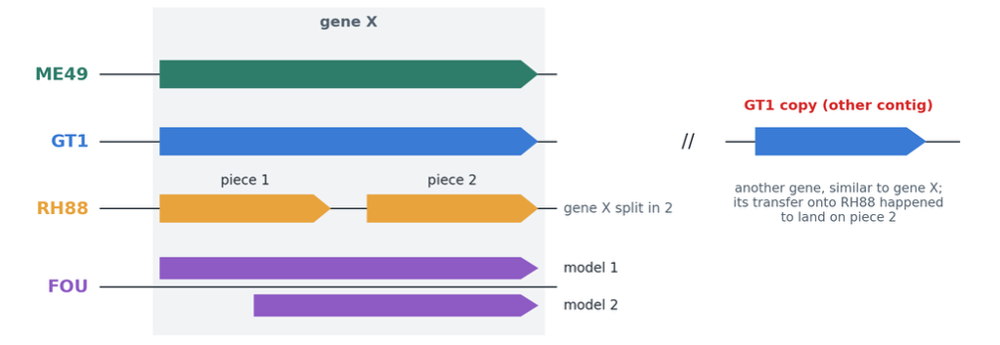

   Two genes are linked when they lie at the same place on the same strand: the Liftoff transfer of one lies over the
   other by at least 20 bp of CDS span. Two genes of the same genome that overlap are linked too. Genes on opposite
   strands are never linked.

   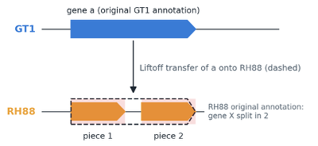

   *The transfer of GT1's gene X onto RH88 lies over both pieces of RH88's model: one link to each.*

   A basket is a group of genes connected by links. Pieces, fused models and duplicate models of a gene therefore end in
   the same basket and compete. A single link can also bring in a gene from elsewhere: here, the transfer of the GT1 gene
   from the other contig happened to land on RH88's piece 2.

   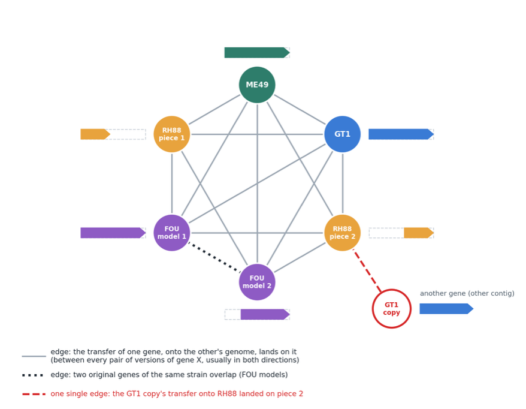

   So each member is then placed on the reference genome, by its own position (a reference gene) or by its transfer onto
   the reference. Members whose places overlap stay together; a member that lands at another place (a copy, e.g. a
   paralogue) leaves and forms a basket of its own. A member with no transfer onto the reference is checked the same way
   on the next genome of the list where it has a transfer. Only when no genome places it is it judged by its
   neighbouring genes (synteny): the baskets of the 3 nearest genes on each side of it, in its own genome, are compared
   with those of the members that keep the basket; it leaves when it shares fewer than 2 of them (its surroundings are
   different), and stays otherwise, or when it has fewer than 2 neighbour baskets to compare. In the example, the
   versions of gene X overlap on ME49 and stay together, while the GT1 copy from the other contig lands at another
   locus of ME49: it leaves gene X's basket and goes to a basket of its own. (The copy rule below runs before the place
   check: if GT1's two proteins align, it is the copy rule that separates the copy; the result is the same.)

   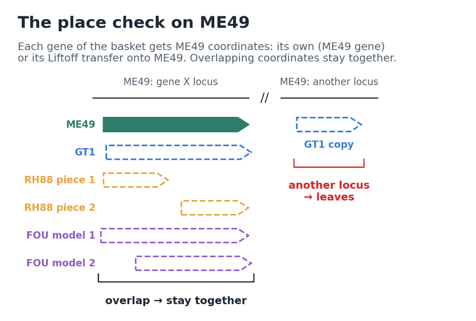

   **Copies in one genome.** The place check does not separate two copies of a gene that land at the same place of the
   reference, e.g. a gene duplicated in one strain only. So, before the place check, two genes of the same genome in
   one basket are compared with each other when they lie at two places of that genome (they do not overlap, and they
   are not neighbours at most 3 genes apart, which are left to the [tandem arrays](#genes-in-tandem-arrays)):
   - their proteins align (blastp identity >= 70%, and the alignment covers >= 70% of the shorter protein): they are
     **two copies**. The copy whose neighbouring genes match those of the other genomes' members less (on a tie, the
     shorter gene) leaves and forms a basket of its own (`copies_split.tsv`), so it gets its own model;
   - their proteins do not align, or align over less than 70% of the shorter: they are **pieces** of one gene
     (different parts of it), and stay together.

   The reference genome's own genes are never split. In *T. gondii*, RH88's `TGRH88_027580` and `TGRH88_018210` (99%
   identical, on two chromosomes) are two copies; ARI's `TGARI_368320` and `TGARI_219540A/B` (the start and the rest of
   one gene, cut by a contig end) are pieces. All the cases of copies are summarised in
   [Copies of a gene in one genome](#copies-of-a-gene-in-one-genome).

2. **Winners.** Each basket has one or more winners: usually one, more when it holds several reference genes or a
   member that does not lie over the winner (another gene), and none when no member passes the filter (below). Each
   winner is an original gene (a gene of one genome's own annotation); its model is considered the correct one and
   is used in point 4. ORFs are checked on the CDS extracted from the genome sequence.

   There are two kinds of baskets, with different rules:

   **1) Baskets with a reference gene.** Every reference gene wins. Each other member is compared with the winners, in
   every genome where both have a model (their own gene or a transfer): when their models lie over each other (20 bp or
   more, same strand) in at least half of these genomes, the member is a version of the winner; otherwise it is another
   gene, and wins too if it passes the filter of 2). Asking for half of the genomes keeps one or two badly transferred
   models from deciding.

   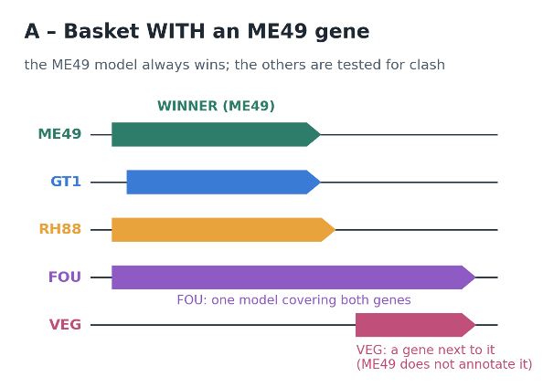

   *FOU's model covers both the ME49 gene and the gene next to it: it is a version of the ME49 gene. The VEG gene does
   not lie over the ME49 gene: it is another gene, and wins if it passes the filter.*

   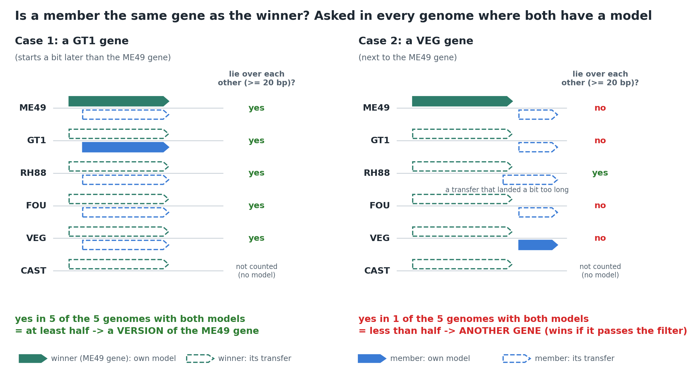

   *The 20 bp is checked in each genome; the answer must be yes in at least half of the genomes where both have a
   model. A single transfer that landed too long (RH88, case 2) does not make two genes one: the VEG gene becomes a
   potential second winner of the basket (it wins if it passes the filter).*

   **2) Baskets without a reference gene.** Here no member is right by default, so the best one is chosen in two
   steps.

   First, a filter keeps, in each basket, only the members that can be trusted to be a real gene. A member passes if
   it has a protein domain, or if it looks like a real protein-coding gene: a valid ORF in at least one genome (its
   own model or a transfer), a protein of at least `MIN_AA` aa (100), and a high enough PSAURON score (0.9 when its
   transfer onto the reference genome works, 0.7 when it is transferred only to other strains). A copy split off by the
   copy rule needs 0.7: the reference annotates the gene (the other copy).

   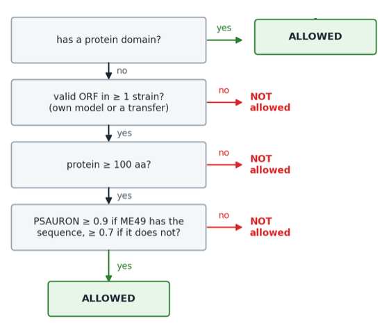

   Then the members that pass are ranked, and the first one wins. The ranking prefers, in this order: a model with no
   N in its CDS, a protein domain, a higher PSAURON score, more **valid votes** (genomes whose own gene matches it and
   has a valid ORF), more **valid transfers** (genomes where its transfer has a valid ORF), and finally a length close
   to the basket's median. The other members at the same place become versions of the winner; a member at another
   place is another gene, and wins too if it passes the filter.

   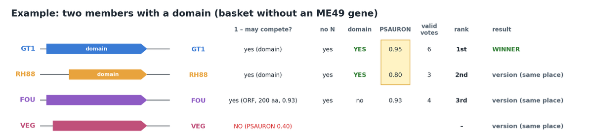

   *GT1 and RH88 both have a domain; GT1 is first on PSAURON (0.95 against 0.80). VEG does not pass the filter (PSAURON
   0.40). RH88, FOU and VEG are at the same place: versions of GT1's gene.*

   When no member passes the filter, the basket has no winner and its genes are not written (`not_eligible.tsv` lists
   why).

   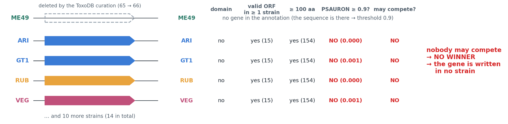

   *A T. gondii gene deleted from ME49 by the ToxoDB curation: its versions in the other strains have a valid ORF of
   154 aa but a PSAURON score close to 0, so none passes the filter and the gene is written in no strain.*

3. **Curation (optional).** Often only the reference annotation has been curated by hand: the curators deleted genes
   they judged false, based on evidence. The other strains were not curated, so those genes are still in their
   annotations, and their transfers would bring them back into the reference and the panel. To keep these false genes
   out, every panel gene at the place of a gene deleted by the curators is removed from all strains. This needs the
   curators' list of deleted genes, and the reference GFF from before the curation, which gives their places
   (`CURATION_REMOVED_LIST`, `OLD_REFERENCE_GFF`).
4. **Each genome's model.** This is where the gene model of each strain is chosen: for each winner, every genome gets
   one model, and the idea is that it should be the model most similar to the winner's. The candidates in a genome are
   the winner's transfer, the genome's own genes in the basket, and the transfers of the other members, all at the
   winner's place. Each candidate is compared with the winner's CDS (minimap2; blastn for CDS shorter than 300 bp). A
   model with an N in its CDS or within 1 kb of a contig end counts as valid, because the assembly, not the model,
   breaks its ORF.

   There are two modes, chosen with `MODES` (both by default; set `MODES="prefer_panel_model"` to write, check and
   plot only that one), each written to `gff_<mode>_final`. **`prefer_panel_model`** follows the rules below.
   **`keep_similar`** was also developed, for when changing the existing models as little as possible is a priority: a
   genome keeps its own model whenever it is similar to the winner's (it covers >= 80% of the winner's CDS, is at most
   120% of its length, has >= 95% identity and a valid ORF), and the rules below apply only when it is not. The
   identity also counts the real sequence differences between the strains, so in a more diverse species fewer own
   models pass the 95%.

   In `prefer_panel_model`, each genome takes, in this order:

   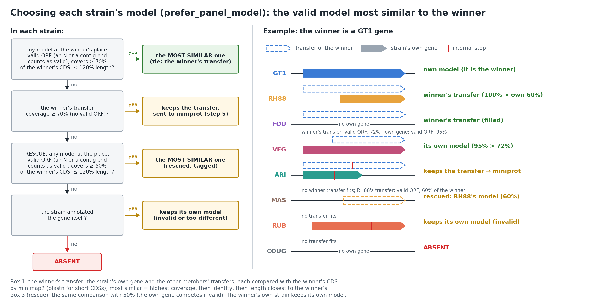

   - the **valid model most similar to the winner's**, covering >= `MIN_COV` (70%) of the winner's CDS and at most
     120% of its length (highest coverage, then identity, then the length closest to the winner's; on a tie, the
     winner's transfer);
   - otherwise, the **winner's transfer without a valid ORF**, when its coverage is >= `MIN_TCOV` (70%): kept, and
     sent to miniprot (point 5);
   - otherwise, a **rescue**: the most similar valid model covering >= `MIN_COV_RESCUE` (50%) of the winner's CDS
     (`model_origin=rescued`);
   - otherwise, its **own model**, when the genome annotated the gene itself;
   - otherwise the gene is **absent** from that genome (`decide/absent.tsv` says why).

   A winner always keeps its own model in its own genome. A transfer is only used at the winner's place (one that lies
   over a gene of another basket is not used), and a model that lies under two winners (a fusion) is never kept. One
   place holds one gene: of two models on the same strand overlapping >= 50%, the one of the reference basket, with a
   valid ORF, present in more genomes, is kept.

   **Genes left without a model.** After the models are chosen, each genome's genes in a basket that no model of the
   basket covers are checked:
   - the basket has a model in this genome: the gene is a **piece** of that gene (e.g. the small piece left over when
     a broken gene is replaced by one model). It is not written: broken genes do not come back;
   - the basket has **no** model in this genome (the transfer was not used or was set aside, e.g. Liftoff put it on a
     similar neighbouring gene): the genome's own gene comes back as it is in its annotation
     (`model_origin=original_other_place`), if it has a domain, or a valid ORF (an N or a contig end within 1 kb counts
     as valid), >= `MIN_AA` aa and a PSAURON score >= `PSAURON_MIN` (0.7) in a basket with a reference gene (the
     reference annotates the gene), or the winners' threshold in a basket without one (0.9 when its transfer onto the
     reference works, 0.7 otherwise). It does not come back where it would lie over a model already written (same
     strand, >= 50% of the smaller). With several such genes, the one with the best PSAURON, then the largest protein,
     comes back, and the others are pieces of it.

   Every gene not written is listed in `left_out.tsv` with the reason. In *T. gondii* ARI, Liftoff swapped the
   neighbouring genes SAG2D and SAG2C (each landed on the other), so both transfers were set aside; ARI's own
   `TGARI_370450` (SAG2D) and `TGARI_370480` (SAG2C) now come back.
5. **Repair with miniprot.** Every gene still with an invalid ORF is aligned again, except selenoproteins (whose
   internal TGA is read as selenocysteine), the reference's pseudogenes, and genes broken by the assembly (an N in the
   CDS, or within 1 kb of a contig end: `orf_status=invalid_assembly_gap` / `invalid_near_contig_end`, not sent). It is
   aligned with miniprot from the winner's protein. A full model with a valid ORF, with the panel model's exon structure
   (same exons, each within 10 bp) and canonical splice sites (GT/GC...AG), replaces it
   (`model_origin=repaired_miniprot`, so a repaired model can always be found); otherwise the gene is flagged with what breaks it (frameshift, internal stop, lost start or stop codon, partial
   alignment).
6. **Overlapping genes.** When two winners lie over each other on **opposite strands** (CDS spans, introns included,
   by 20 bp or more), one of them is probably false. The two are compared in each genome where both are present, and
   one loses when:
   - one is a reference gene and the other has no protein domain: the other loses;
   - only one has a protein domain: the one without loses;
   - neither has a domain: the one with the lower PSAURON score loses, then the one with a valid ORF in fewer
     genomes, present in fewer genomes, with the shorter CDS.

   Neither loses when both are reference genes, both have a domain, or one is a reference gene and the other has a
   domain. A gene that loses in at least `OVERLAP_MIN_STRAINS` genomes (2; 1 for a gene present in a single genome) is
   considered false and removed from every genome. This step runs last, so that the genes already removed and the
   miniprot repairs count. Overlaps on the same strand are not considered here: two models at the same place on the
   same strand are versions of one gene, settled before (points 2 and 4).

   Removing a false gene can free a place. In point 4, when the models of two winners fall at the same place in a
   genome (same strand, overlapping by 50% or more), only one is kept and the other is set aside. If the one kept is
   later removed here as false, the model set aside gets its place back: it is written again, tagged
   `restored_after_removal_of=<the removed gene>`. Otherwise that genome would miss a gene only because a false gene
   had taken its place first.

   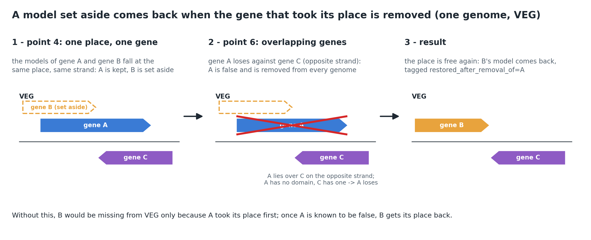
7. **Checks.** The final GFFs are checked before they go to get_pangenes; the log ends with `all checks passed`, or
   lists the problems found:
   - every gene ID is unique across all genomes (get_pangenes needs it);
   - every gene has a CDS (except the reference's pseudogenes), and its transcript, exons and CDS lie inside it, on
     its contig and strand;
   - no two genes of a genome sit at the same place (same strand, CDS spans overlapping by 50% or more of the smaller):
     one place, one gene;
   - every protein-coding gene of the reference annotation is written in the reference genome, unless it was removed
     on purpose (curation or overlap rule).
8. **Plots** of the results, the modes of `MODES` side by side (listed in [Outputs](#outputs)). They can be redone
   alone, for example for one mode only, without running the step again (see [Running it](#running-it)).
9. **Gene fate.** Every gene of every genome's own annotation is accounted for (`gene_fate_<mode>.tsv`): the final
   model of its own panel gene at its place (a model of its basket overlapping its CDS span), or the record that
   explains why it has none (not eligible, left out, panel gene removed by the curation or the overlap rule, one place
   one gene). A model of another panel gene at its place does not keep it; it is listed as `overlapped_by`. The job
   stops with an error when a gene has neither.
10. **Gene balance and eliminated genes**, two figures made from the gene fate:
    - why each genome has fewer (or more) genes in the final GFF than in its own annotation. Every own gene and every
      final gene is counted once (the script stops if the balance does not close). Losses: genes removed with their
      contig before step 05 (step 01) and TE genes (step 02), both from the files given in `REMOVED_GENES`,
      `REMOVED_CONTIGS` and `ORIGINAL_GFF_DIR`; pieces of one gene replaced by one model; genes eliminated by the
      quality rules (not eligible, or left out because their own model failed the check); genes removed at the end
      of step 05 (overlap rule, curation, one place one gene). Gains: models where the genome had no gene, one gene
      split in two, tandem copies;
    - the genes eliminated by the quality rules (the red bar of the first figure), by the signs against them, each
      checked on its own: PSAURON below the cut-off, < `MIN_AA` aa, no valid ORF, and overlap (a gene of another panel
      gene lies over it);
    - the PSAURON histograms of these genes, one panel per genome: all of them, and the ones eliminated by PSAURON
      only.


### Genes in tandem arrays

Some gene families have several copies next to each other (tandem arrays), and the number of copies can differ between
strains (e.g. ROP5 in *T. gondii*). The transfers of one copy land on the neighbouring copies too, so all the copies end
up in one basket. Without a special case, a strain would keep one model per winner and lose its extra copies.

A basket holds a tandem array when, in at least one genome, two or more of its own genes:
- lie on the same strand, without overlapping each other, at most 3 genes apart;
- have proteins of similar length, and similar to each other (blastp identity >= 70%, covering >= 70% of each).

Two pieces of one gene do not pass this test, because each piece covers only part of the other.

Each genome first gets its models as for any other basket (points 2-4). Then the copies are added on top:
- the genome's own genes that passed the test (`model_origin=original`);
- the transfer of another genome's copy, if it has a valid ORF, covers >= 70% of the copy (`MIN_TCOV`), and lands
  where the genome has no gene of the basket (`model_origin=filled`).

A copy is added only at a free place: it must not overlap, on the same strand, a model already written for the basket
or another added copy. A transferred copy is also not added where it would lie over (by 50% or more) a gene of another
basket. The added copies are tagged `tandem_array_copy=True`.

### Copies of a gene in one genome

A genome can have two (or more) copies of a gene, not pieces: whole genes with the same sequence. How they are treated
depends on where they are:

| Two copies in one genome | Handled by | Result |
|---|---|---|
| they land at **different places of the reference** (the reference has two copies too) | the place check (point 1) | each copy is in the basket of its reference locus |
| they land at the **same place of the reference** (only this genome has two), and are **far apart** in the genome (another contig, or more than 3 genes apart) | the copy rule (point 1): their proteins align (identity >= 70%, covering >= 70% of the shorter) | the copy whose neighbours match those of the other genomes less gets a basket of its own; it becomes a panel gene of its own if it passes the filter of point 2 (e.g. *T. gondii* RH88 `TGRH88_027580`) |
| they are **neighbours** (same contig and strand, at most 3 genes apart) | the [tandem arrays](#genes-in-tandem-arrays) | they stay in one basket and every copy is kept (`tandem_array_copy=True`; e.g. ROP5) |

A copy split off by the copy rule becomes a separate panel gene, so it can end in a different pangene from the copy it
came from; tandem copies stay in the same panel gene.

Copies are missed, and the extra copy is left out as a piece (`left_out.tsv`, with its reason), when:
- their proteins are below 70% identity, or align over less than 70% of the shorter one (divergent or partial copies);
- they are neighbours but fail the tandem test (similar lengths, blastp identity >= 70% covering >= 70% of each), e.g.
  *T. gondii* RH88 ROP5 `TGRH88_057720`.

### Settings

All settings are at the top of [`scripts/basket_annotation_job.sh`](scripts/basket_annotation_job.sh), between the
`Edit these` lines. Each one can also be set on the command line, without editing the script (see
[Running it](#running-it)); the value in the script is then the default.

| Setting | Default | What to put |
|---|---|---|
| `GENOMES` | `genome_order.txt` | the genome list, **the reference first** (it defines the reference and the genome index of the new IDs) |
| `NATIVE_DIR` | `gff_for_liftoff` | step 3's prepared GFFs: the annotations given to Liftoff, so they match the transfers |
| `TRANSFER_DIR` | `liftoff_output/polished` | step 4's transfers, `<source>_onto_<target>_liftoff.gff3_polished` |
| `DOMAIN_DIR` | `annotation_check` | step 1's `<genome>_gene_classification.tsv` tables (column `has_domain`) |
| `GENOME_DIR`, `GENOME_SUFFIX` | `genomes`, `.fna` | the genome FASTA files given to Liftoff |
| `OLD_REFERENCE_GFF` | `""` (none) | the reference GFF from before a manual curation of the reference |
| `CURATION_REMOVED_LIST` | `""` (none) | the curators' list of the genes they deleted (one ID of `OLD_REFERENCE_GFF` per line); only these genes count as deleted, the old GFF gives their places. Without it, every old gene whose ID is no longer in the reference GFF counts as deleted, which also catches renamed genes and genes removed for other reasons (in *T. gondii*: 1,319 genes instead of the 268 of the list) |
| `ID_PREFIX` | `""` (**required**) | prefix of the new gene IDs (e.g. `Tg` gives `Tg1g00001`) |
| `MODES` | `"keep_similar prefer_panel_model"` | both modes, or only one of them: only its GFFs, checks and plots are made |
| `MIN_COV` | `0.7` | each genome's model: share of the winner's CDS a valid model must cover |
| `MIN_TCOV` | `0.7` | the winner's transfer without a valid ORF is kept for miniprot from this Liftoff coverage |
| `MIN_COV_RESCUE` | `0.5` | rescue before absent: share of the winner's CDS a valid model must cover |
| `MINIMAP2_MODULE` | `""` | the module that loads minimap2; `""` if it is already on the PATH |
| `MIN_AA` | `100` | shortest protein a gene not annotated in the reference (and without a domain) can win with |
| `PSAURON_DIR` | `psauron` | where the PSAURON scores come from: the folder written by step 04 ([`psauron_array_job.slurm.sh`](../04_Protein_evidence/scripts/psauron_array_job.slurm.sh)). A candidate without a score there stops the job. Set `""` only if step 04 did not score the proteins |
| `RUN_PSAURON` | `no` | used only when `PSAURON_DIR` is `""`: `yes` makes this job score the genes it needs itself; `no` means no scores, so the filter does not use PSAURON |
| `PSAURON_CMD` | `singularity exec <container>.sif psauron` | the command that runs PSAURON (a container with PSAURON; set the path to yours), used with `RUN_PSAURON="yes"` |
| `PSAURON_MIN_IN_REF`, `PSAURON_MIN` | `0.9`, `0.7` | minimum PSAURON score: when the gene's transfer onto the reference works, and when it is transferred only to other strains |
| `OVERLAP_MIN_STRAINS` | `2` | genomes in which a gene must lose an opposite-strand overlap to be removed |
| `RUN_MINIPROT` | `yes` | `yes` repairs the genes with an invalid ORF with miniprot (point 5); `no` skips that point |
| `MINIPROT_MODULE` | `miniprot/0.18` | the module that loads miniprot; `""` if it is already on the PATH |
| `PLOT_LABEL` | `panel` | prefix of the plot files |
| `REMOVED_GENES` | `""` | for the gene balance: tables of the genes removed before step 05 (columns genome or genome_label, gene or gene_id), or one GFF per genome with `{genome}` in the path; several separated by `\|`, each `FILE` or `FILE:REASON` |
| `REMOVED_CONTIGS` | `""` | for the gene balance: tables of the contigs removed in step 01 (columns genome, contig, or lines `genome contig`); several separated by `\|`, each `FILE:REASON` |
| `ORIGINAL_GFF_DIR` | `""` | the GFFs before the contigs were removed, to find the genes on `REMOVED_CONTIGS` |
| the `ADAPT` block | | how python3, blastn, minimap2 and miniprot are put on the PATH on your cluster |

### Running it

```bash
mkdir -p basket_annotation/logs
sbatch 05_Basket_annotation_integration/scripts/basket_annotation_job.sh
```

Any setting can be changed on the command line instead of in the script, for example:
```bash
sbatch --export=ALL,MIN_COV=0.8,MODES=prefer_panel_model 05_Basket_annotation_integration/scripts/basket_annotation_job.sh
```

For the gene balance, the files of steps 01 and 02 that removed genes are given as settings. In *T. gondii* (paths
relative to the project folder, as on the cluster):
```bash
sbatch --export=ALL,REMOVED_GENES="01_Genome_Selection_QC/contig_size_profile/small_contig_genes.tsv:contig < 10 kb",REMOVED_CONTIGS="01_Genome_Selection_QC/apicoplast_screen/apicoplast_contigs.tsv:apicoplast contig|01_Genome_Selection_QC/redundant_contigs_removed.tsv:redundant contig",ORIGINAL_GFF_DIR=gff_originals 05_Basket_annotation_integration/scripts/basket_annotation_job.sh
```

The final GFFs are in `basket_annotation/gff_<mode>_final/`; they go to get_pangenes (step 06) as
they are.

To redo only the gene fate and its figures (points 9-10) on results already written, e.g. with other files of
steps 01 and 02 (the same settings):
```bash
sbatch 05_Basket_annotation_integration/scripts/gene_fate_job.sh
```

To redo only the plots, for example for one mode, from the final GFFs already written (nothing else is run). They go
to `basket_annotation/plots/` with the modes in their names (e.g. `<label>_prefer_panel_model_orf_quality.png`), so the
job's own plots are not overwritten:
```bash
sbatch --export=ALL,MODES=prefer_panel_model 05_Basket_annotation_integration/scripts/plot_basket_annotation_job.sh
```

### Outputs

| File | Content |
|---|---|
| `baskets_v2.tsv`, `winners.tsv` | each basket, its members and winners (empty for a basket without a winner); each panel gene with its support, the genomes it is in, its protein length and PSAURON score |
| `tandem_arrays.tsv` | the baskets that hold a tandem array: their winners, the number of copies in each genome, and the copies |
| `not_eligible.tsv` | members that could not win, and why (no valid ORF in any genome, too short, low PSAURON) |
| `members.tsv` | every member: its basket's winners, protein length, own ORF (`valid`, `gap`, `end`, `invalid`), domain, PSAURON, and `keep_check` (empty = its own model may come back where its basket has no model; otherwise why not) |
| `copies_split.tsv` | the copies split off into baskets of their own: the copy, its genome, and the copy that kept the basket |
| `psauron_candidates.faa`, `psauron_candidates.csv` | with `RUN_PSAURON="yes"`: the proteins scored in the job and their scores (re-used by the next run) |
| `decide/decisions.tsv`, `decide/summary.tsv` | what each genome takes for each panel gene, in both modes, and the ORF status of the model taken (`valid`, `gap`, `end`, `invalid`) |
| `decide/absent.tsv` | each panel gene absent from a genome, and why: no transfer into the genome, transfers with low coverage, not at the place, no valid ORF, or valid models that cover too little of the panel gene; with the panel gene's transfer coverage and the closest model found |
| `decide/array_models.tsv` | the tandem-array copies added to each genome: the basket's winners, the genome, the copy, own gene or transfer, its ORF status |
| `decide/own_invalid_orf.tsv` | genes whose own model has an invalid ORF in their own genome, and why (start, stop, frame, internal stops); the reference genes are those of the first genome |
| `gff_<mode>/<genome>_basket_annotation.gff` | the draft GFFs (before miniprot and the overlap rule) |
| `gff_<mode>/summary.tsv` | genes per genome, by origin of the model |
| `gff_<mode>/removed_panel_genes.tsv` | panel genes removed by the curation |
| `gff_<mode>/stacked_dropped.tsv`, `<genome>_stacked_dropped.gff` | models not written because another panel gene's model was at the same place |
| `gff_<mode>/left_out.tsv` | genes of a basket with a winner that no model covers and that are not written: piece of a gene that has its model here, or why its own model failed |
| `gff_<mode>_miniprot/` | the GFFs after miniprot, and `miniprot_results.tsv` (one row per gene tried, with the result) |
| `gff_<mode>_final/` | **the final GFFs**; `removed_panel_genes.tsv` (curation and overlap), `overlap_losses.tsv` (every panel gene that loses an overlap, in how many genomes, and against which genes), `restored_genes.tsv` |
| `plots/<label>_*.png` | `model_origin`, `orf_quality`, `gene_counts`, `panel_genes`, `miniprot`, and `<label>_summary.tsv` with their numbers |
| `gene_fate_<mode>.tsv` | every gene of every genome's own annotation: `kept` (with the final model of its panel gene at its place), `left out`, `not eligible`, `panel gene removed` or `one place, one gene` (with the reason), and `overlapped_by` (final genes of other panel genes at its place); `NO RECORD` stops the job |
| `plots/<label>_<mode>_gene_balance.png`, `.tsv` | each genome from its own annotation to the final GFF: losses and gains by category |
| `plots/<label>_<mode>_eliminated_reasons.png`, `<label>_<mode>_eliminated.tsv` | the genes eliminated by the quality rules, by their signs; one row per gene with its signs, protein length, PSAURON and the genes over it |
| `plots/<label>_<mode>_eliminated_psauron.png`, `_eliminated_psauron_only.png` | the PSAURON histograms of the eliminated genes, per genome: all of them, and the ones eliminated by PSAURON only |

### Attributes written in the GFFs

Every gene gets a new unique ID, `<ID_PREFIX><genome index>g<number>`, numbered along the genome. Every attribute of
the source model is kept on its gene, mRNA, exon and CDS lines (e.g. the InterPro `Dbxref` of the CDS); only `ID` and
`Parent` are replaced. A model repaired by miniprot keeps the attributes of the model it replaces, except Liftoff's ORF
marks (`valid_ORF`, `valid_ORFs`, `missing_start_codon`, `missing_stop_codon`, `inframe_stop_codon`), which described the
old model. The gene line also gets, in column 9:

| Attribute | Meaning |
|---|---|
| `original_ID` | the genome's own gene ID, when its gene was kept or replaced (absent when the gene was filled) |
| `model_from` | the gene the model comes from |
| `model_origin` | `original`, `original_divergent` (no transfer fitted), `original_other_place` (the genome's own gene, back because its basket had no model in the genome), `replaced`, `filled`, `alternative`, `rescued` (a valid model covering 50-70% of the panel gene), `target_invalid_orf`, `repaired_miniprot` |
| `basket` | the panel gene (the basket's winner) |
| `has_domain` | InterPro/Pfam domain of `model_from` |
| `not_in_reference_annotation` | the panel gene has no gene in the reference annotation |
| `orf_invalid` | the model has no valid ORF |
| `low_coverage_transfer`, `transfer_coverage` | the transfer was used with a coverage below 80% |
| `selenoprotein` | the description names a selenoprotein |
| `pseudogene` | the model is an annotated pseudogene, written as gene + transcript + exon (no CDS) |
| `frameshift`, `stop_codon`, `start_codon_lost`, `stop_codon_lost`, `partial_alignment`, `no_miniprot_hit`, `miniprot_repair_overlaps_another_gene`, `miniprot_repair_noncanonical_intron`, `miniprot_repair_structure_differs` | why miniprot could not repair it |
| `tandem_array_copy` | an extra copy of a tandem array, added on top of the genome's model for the panel gene (`basket`) |
| `restored_after_removal_of` | the model had lost its place to that panel gene, which the overlap rule removed later |
| `orf_status` | one value per gene, to filter or colour by: `valid`, `repaired_miniprot`, `selenoprotein`, `pseudogene`, `invalid_assembly_gap` (an N in the CDS) or `invalid_near_contig_end` (within 1 kb of a contig end) - the assembly explains the broken ORF, so the gene is not sent to miniprot - and `invalid` (broken, not explained by the assembly) |

### Scripts

Steps 1-4: the scripts named in each step. Step 5, run by
[`scripts/basket_annotation_job.sh`](scripts/basket_annotation_job.sh), in order:
[`prepare_pseudogenes.py`](scripts/prepare_pseudogenes.py),
[`baskets_v2.py`](scripts/baskets_v2.py), [`decide_models.py`](scripts/decide_models.py),
[`build_basket_annotation.py`](scripts/build_basket_annotation.py),
[`repair_with_miniprot.py`](scripts/repair_with_miniprot.py),
[`overlap_filter.py`](scripts/overlap_filter.py),
[`check_basket_annotation.py`](scripts/check_basket_annotation.py),
[`plot_basket_annotation.py`](scripts/plot_basket_annotation.py),
[`gene_fate.py`](scripts/gene_fate.py), [`plot_gene_fate.py`](scripts/plot_gene_fate.py),
[`plot_eliminated_psauron.py`](scripts/plot_eliminated_psauron.py).
[`plot_basket_annotation_job.sh`](scripts/plot_basket_annotation_job.sh) redoes only the plots, and
[`gene_fate_job.sh`](scripts/gene_fate_job.sh) only points 9-10 (gene fate and its figures) on results already written.
[`build_baskets.py`](scripts/build_baskets.py) holds the GFF reader they share, and [`check_orf.py`](scripts/check_orf.py)
(a copy of step 07's ORF check) the ORF check used by `decide_models.py` and `repair_with_miniprot.py`.
