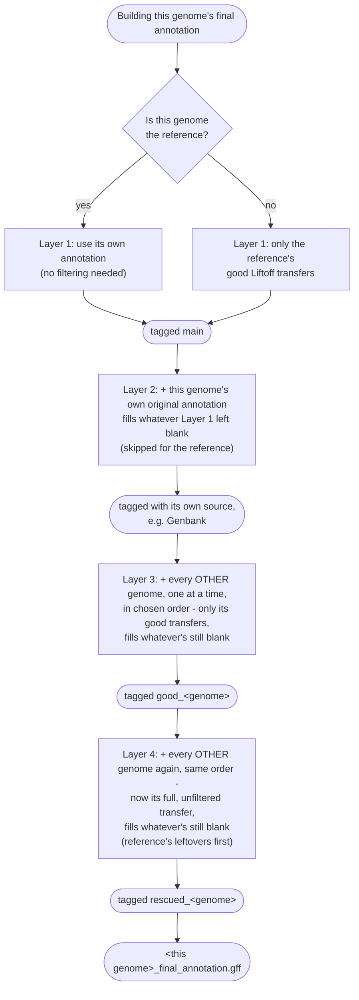

# 05 – Cross-genome annotation integration (all-vs-all approach)

***Purpose:*** To obtain accurate and consistent gene annotations across all genome assemblies, reducing annotation-related biases in the pangenome analysis.


A key premise of pangenome analysis is that gene annotation has to be **consistent across
every genome** in the set. If a gene is genuinely present in a genome, its annotation should
call it - a real locus missing from the pangenome matrix just because one genome's annotation
happened to miss it is an artefact, not biology. In practice, genome annotations
are frequently produced by different research groups using different tools and methodologies,
and depending on the tool/evidence used, the same real gene can get called in one strain's
annotation and missed in another's - not because the gene is truly absent, but because of how
it was annotated. 

We therefore developed a pipeline to **transfer and integrate gene
annotations**, producing a more consistent annotation across genomes of the same species.

Nevertheless, this approach has important limitations. Even when a transferred gene model contains a valid open reading frame, the pipeline cannot determine whether the gene is active or functional. A gene may have its expression affected by mutations in regulatory regions that are not evaluated by the pipeline. Moreover, pseudogenes are also considered in the pipeline; although disrupted genes may contain a genuine loss-of-function mutation, the apparently disruption could also be result from a sequencing or assembly error. Distinguishing among these possibilities is not trivial and is beyond the scope of this pipeline at this moment. Therefore, the presence of an annotated gene model should not necessarily be interpreted as evidence that the gene is functional.

This pipeline builds that consistent annotation around an **all-vs-all Liftoff transfer**:
every genome's genes get transferred onto every other genome. The **reference** - the one
genome whose annotation you trust the most, picked before anything else runs - is transferred
first as the trusted `main` layer. Then **two distinct
approaches exist to build the final annotation**, complementing each
genome's annotation with its own original annotation or the ones coming from other strains' genomes. In summary, the approaches are:

- [Step 5](#step-5-build-each-genomes-final-annotation-priority-order) - a fixed priority order
  of sources: only the reference's "good" transfers first (valid gene model, high enough
  coverage and sequence identity), then that genome's own original annotation, then every other
  genome's transfers - "good" ones before low-confidence leftovers - so one genome's weak
  transfer never blocks a better version of the same gene coming from a different genome.
- [Step 8](#step-8-build-each-genomes-final-annotation-best-model) - SADIK TO WRITE HERE


## Table of contents

1. [Native annotation check](#step-1-native-annotation-check)
2. [Remove specific genes from the GFFs (optional, manual kill list)](#step-2-remove-specific-genes-from-the-gffs-optional-manual-kill-list)
3. [Prepare the GFFs for Liftoff](#step-3-prepare-the-gffs-for-liftoff)
4. [Liftoff](#step-4-liftoff)
5. [Build each genome's final annotation (priority order)](#step-5-build-each-genomes-final-annotation-priority-order)
6. [Built annotation check (if using Step 5)](#step-6-built-annotation-check-if-using-step-5)
7. [Final annotation (if using Step 5, pre-get_pangenes)](#step-7-final-annotation-if-using-step-5-pre-get_pangenes)
   - [7a. Filter (drop unsupported genes before get_pangenes)](#7a-filter-drop-unsupported-genes-before-get_pangenes)
   - [7b. No filtering (tag, decide after get_pangenes)](#7b-no-filtering-tag-decide-after-get_pangenes)
8. [Build each genome's final annotation (best model)](#step-8-build-each-genomes-final-annotation-best-model)

## Dependencies

| Program | Used by | Suggestion |
|---|---|---|
| AGAT | Step 2, Step 5 | micromamba env (`bioinfo` here) |
| python3 (standard library only) | Step 3, Step 7a (filter itself), Step 7b | `module load python/3.11.9` (or any python3 on the PATH - nothing else needed) |
| python3 + pandas + matplotlib | Step 1, Step 6, Step 7a (QC plot) | micromamba env (`synteny` here), already installed if you set it up for [step 01](../01_Genome_Selection_QC/README.md#dependencies) |
| Liftoff | Step 4 | `module load liftoff` (or your cluster's own) |

These are hardcoded in each script's `### ADAPT ###` block - edit that block to point to your
own.

## Steps


### Step 1: Native annotation check

**In short:**
- Reads every genome's own GFF, **before Liftoff runs** - each genome's annotation exactly as
  its own source produced it (plus InterPro/PFAM evidence added by step 04).
- Classifies every gene into protein-coding / pseudogene / tRNA / rRNA / other non-coding /
  unclassified, whatever naming convention the source annotation used.
- Checks how many protein-coding genes carry domain evidence.
- Counts overlapping gene pairs per genome, same-strand vs. opposite-strand, at three levels of
  strictness, plus a minor/substantial/contained severity breakdown.
- Read-only - never edits any GFF.

Scripts: [`scripts/analyze_input_gffs_job.sh`](scripts/analyze_input_gffs_job.sh) ·
[`scripts/analyze_input_gffs.py`](scripts/analyze_input_gffs.py). Read-only - it never edits any GFF.
Run once, after [step 04 - InterProScan](../04_InterProScan/README.md) - the domain-evidence
columns and plots (`has_domain`) only mean anything once InterPro/PFAM hits are written into the
GFFs.

**How genes are classified.** Different sources describe genes differently - one might call a
protein-coding gene `protein_coding_gene` directly, another plain `gene` with a
`gene_biotype=protein_coding` attribute, another neither - so this also doubles as a check that
this project's downstream scripts are actually reading each genome's gene calls correctly. For
each gene-level feature (any feature type containing "gene" - `gene`, `protein_coding_gene`,
`pseudogene`, `tRNA_gene`, ...), in order:
1. **By feature type**, if it's one of the specific ones above (`protein_coding_gene`,
   `pseudogene`, `tRNA_gene`, `rRNA_gene`, `ncRNA_gene`, ...) - no ambiguity, done.
2. Otherwise (plain `gene`, or anything else not in that list), **by attribute** -
   `gene_biotype=` (NCBI/GenBank-style) or `biotype=` (Ensembl-style).
3. Otherwise, **by its own children** - if it has a `CDS` descendant anywhere below it, it's
   protein-coding; a `tRNA`/`rRNA` descendant makes it that; a `pseudogenic_transcript`
   descendant makes it a pseudogene; other non-coding RNA descendant types
   (`ncRNA`/`lnc_RNA`/`snRNA`/`snoRNA`/`miRNA`/`misc_RNA`) bucket together as "other
   non-coding."
4. If none of the above gives an answer, the gene is **unclassified** - flagged so it gets a
   manual look rather than being silently miscounted as something it might not be.

Every distinct (genome, feature type, how it was classified) combination found is written to
`feature_attribute_table.tsv` - check this first if a genome's numbers look off, or if any
gene came back unclassified. A genome reporting zero gene-level features at all means its GFF
doesn't use "gene" anywhere in its feature type names - a convention this script doesn't
recognize, worth a manual look at that genome's GFF directly.

**Domain evidence** is the same check the filter ([step 7](#step-7-final-annotation-if-using-step-5-pre-get_pangenes)) itself uses: a protein-coding
gene "has a domain" if any of its CDS lines carries an `InterPro:`/`PFAM:` hit in `Dbxref=`.
Because this check reads step 04's output, that evidence is this project's own InterProScan
result for every genome. Genes without a hit are not necessarily wrong - many real genes have no
recognisable domain - but the numbers give a baseline for the "protein domain" evidence that
the filter step relies on, and `has_domain` in `cds_overlapping_pairs.tsv` helps decide which
gene of an overlapping pair is the more credible one.

**Overlapping genes** - protein-coding and pseudogene genes only (overlap between two
non-coding RNA genes, or between a non-coding and a coding one, isn't the
same-locus-consistency problem this pipeline is checking for) - counted per genome, split by
whether the pair is on the same strand or opposite strands, at three levels:

- **gene overlap** - do the two genes overlap at all, using the raw `gene` line's own
  start/end (this includes any annotated UTR);
- **core-span overlap** - same question, but using only the extent of each gene's CDS/exon
  (UTR excluded - ignores introns within either gene, just their outer boundary);
- **CDS-to-CDS collision** - do their actual CDS segments overlap.


**CDS-overlap severity.** For every CDS-collision pair, severity is based on how much of the
overlap covers the ***smaller*** gene's own CDS:

- **minor** (< 20%): likely just gene-model boundary noise, not necessarily a wrong call;
- **substantial** (20-80%): ambiguous, worth a look;
- **contained** (≥ 80%): one gene is essentially sitting inside the other - a strong candidate
  for one of the two being a spurious/duplicate call.

Same rule and thresholds as step 05's own `plot_final_annotation_qc.py` (post-Liftoff build), so
the two are directly comparable.

#### Running it

**Edit the settings at the top of `analyze_input_gffs_job.sh`**:

| Variable | Default | Meaning |
|---|---|---|
| `GENOMES` | `genome_order.txt` | Comma-separated genome names, or a path to a file with one per line (e.g. `genome_order.txt`) |
| `GFF_DIR` | `gff_with_interpro` | Directory with every genome's `<genome>.gff3`/`.gff` including InterPro evidence |
| `OUT_DIR` | `annotation_check` | Where to write the tables and plots |

**Run:**
```bash
sbatch analyze_input_gffs_job.sh
```

**Output**, in `OUT_DIR`:

| File | Shows |
|---|---|
| `feature_attribute_table.tsv` | every distinct (genome, feature type, how it was classified) combination found, with a count - start here if a genome's numbers look wrong |
| `gene_biotype_counts.tsv` | per genome: protein-coding (split by domain evidence present/absent), pseudogene, tRNA, rRNA, other non-coding, unclassified |
| `overlap_counts.tsv` | per genome: overlapping protein-coding/pseudogene pairs, split same-strand/opposite-strand, for the raw gene-overlap count, the core-span overlap count, and the CDS-collision count - plus, for the CDS-collision pairs, a minor/substantial/contained severity breakdown (both strands combined) |
| `<genome>_gene_classification.tsv` | one row per gene - id, feature type, category, how it was classified, domain evidence, coordinates |
| `cds_overlapping_pairs.tsv` | one row per CDS-overlapping gene pair, across every genome - both genes' id, description, coordinates, CDS length and domain evidence (has_domain), plus the overlap in bp and its severity |
| `01_gene_counts_protein_coding.png` | protein-coding genes (split: has domain evidence / doesn't) + pseudogenes, per genome, with totals labeled on top of each bar |
| `02_gene_biotype_breakdown.png` | every gene category found, per genome, totals on top |
| `03_gene_overlap_counts.png` | any overlap at all (raw `gene` line span, UTR included), per genome, split same-strand/opposite-strand, totals on top |
| `04_core_overlap_counts.png` | core-span (CDS/exon extent, UTR excluded) overlapping gene pairs, per genome, split same-strand/opposite-strand, totals on top - a subset of 03's counts, usually much smaller |
| `05_cds_overlap_counts.png` | actual CDS-to-CDS collisions, per genome, split same-strand/opposite-strand, totals on top - a subset of 04's counts, shown as its own plot since stacking all three together would make the smaller ones invisible |
| `06_cds_overlap_severity.png` | the same CDS-collision pairs as 05, both strands combined, split minor/substantial/contained - the pre-Liftoff baseline to compare against step 05's later post-Liftoff `plot_final_annotation_qc.py` output |

`cds_overlapping_pairs.tsv`'s `gene*_description` comes from `description=` on the gene line
itself (FungiDB-style) or, if that's absent, `product=` on a descendant CDS/mRNA (NCBI-style) -
whichever this genome's source annotation actually used. `gene*_has_domain` is blank for a
pseudogene (not tracked for that category, same as `gene_biotype_counts.tsv`) - for a
protein-coding gene it can be `False` even when the description itself reads like a real
function (e.g. "Has domain(s) with predicted role in..."): that description is this genome's
own prior functional annotation, while `has_domain` here is strictly whether this project's own
InterProScan run (or the original annotation) left an `InterPro:`/`PFAM:` hit in this gene's
`Dbxref=` - see the "Known limitation" further down for why a genome's original annotation
alone can show 0% (which is why this check runs on step 04's output).

### Step 2: Remove specific genes from the GFFs (optional, manual kill list)

If some genes are confirmed to be wrong and must be deleted (e.g. 5 genes that are known to be wrong in *T. gondii* M49 last annotation), strip them out before Liftoff.

Scripts: [`scripts/remove_genes_from_gff_job.sh`](scripts/remove_genes_from_gff_job.sh) ·
[`scripts/remove_genes_from_gff.py`](scripts/remove_genes_from_gff.py)

- Removing a gene removes every feature nested under it too (mRNA, exon, CDS, UTR, ...), so
  no orphaned child lines are left behind.
- The input GFFs are never edited. Every genome in the genome list gets a copy in `OUT_DIR`,
  with the kill-listed genes stripped from it (a genome with nothing on the list is copied
  unchanged), so `OUT_DIR` is a complete drop-in replacement for the input directory - point
  the following steps at it.

**Kill list**: a TSV with no header, one gene per line, two columns - `genome<TAB>gene_id`
(`#` lines and blank lines are ignored). The ID has to match the gene's `ID=` attribute in
that genome's GFF; a gene ID only applies to the genome named on its own line.

```
# kill_list_manual.tsv
ME49	TGME49_242250
ME49	TGME49_224780
```

**Edit the settings at the top of `remove_genes_from_gff_job.sh`**:

| Variable | Default | Meaning |
|---|---|---|
| `GENOMES` | `genome_order.txt` | Comma-separated genome names, or a path to a file with one per line (e.g. `genome_order.txt`) |
| `GFF_DIR` | `gff_with_interpro` | Directory with every genome's GFF to remove genes from |
| `KILL_LIST` | `kill_list_manual.tsv` | The kill list TSV described above |
| `OUT_DIR` | `gff_curated` | Where to write the curated GFFs - must differ from `GFF_DIR` |

**Run:**
```bash
sbatch 05_Cross-genome_annotation_integration/scripts/remove_genes_from_gff_job.sh
```

**Output** - everything goes to `OUT_DIR` (default **`gff_curated/`**, next to `gff_with_interpro/`, in the
project folder):

| File | What it is |
|---|---|
| `gff_curated/<genome>.gff3` | one GFF **per genome in the list** - the kill-listed genes (and everything nested under them) removed; genomes with nothing on the kill list are identical copies. Same file name as the input, so it is a drop-in replacement for `gff_with_interpro/` |
| `gff_curated/removed_genes_report.tsv` | one row per removed gene: genome, gene ID, feature type, number of GFF lines removed |
| `remove_genes_from_gff_<jobid>.out` / `.err` | the job logs, in the folder you submitted from (not in `gff_curated/`) |

`gff_with_interpro/` itself is never changed. [Step 3](#step-3-prepare-the-gffs-for-liftoff) reads
`gff_curated/`; if you skip this step (no genes to remove), point step 3 at `gff_with_interpro/` instead.

**Checking it worked:** the job's `.err` log has one block per genome with kill-listed genes -
how many genes and GFF lines were removed, per gene - and a `WARNING` for any ID that wasn't
found (a typo in the ID, or the wrong genome name on that line; nothing is removed for it).
`<OUT_DIR>/removed_genes_report.tsv` has the same numbers as a table.

### Step 3: Prepare the GFFs for Liftoff

Scripts: [`scripts/prepare_for_liftoff_job.sh`](scripts/prepare_for_liftoff_job.sh) ·
[`scripts/prepare_for_liftoff.py`](scripts/prepare_for_liftoff.py)

Two things, done on a copy - the input GFFs are never edited.

**1. Choose what Liftoff transfers.** Liftoff only transfers top-level features whose type is in
its list: `gene` by default, plus whatever a `-f` types file adds - the match is exact, so
`protein_coding_gene`, `pseudogene` or `ncRNA_gene` are not transferred unless listed.

Different sources name genes differently (FungiDB: `protein_coding_gene`, `ncRNA_gene`; NCBI:
plain `gene` for everything, told apart only by `gene_biotype=`). So each gene is first
classified - same rules as the [native annotation check](#step-1-native-annotation-check): by
feature type, else `gene_biotype=`/`biotype=`/`ebi_biotype=`, else by what's nested under it -
then retyped:

- **Protein-coding genes and pseudogenes** get their feature type (column 3) rewritten to
  `protein_coding_gene`, which is then written into `liftoff_feature_types.txt` - the list
  passed to Liftoff with `-f`. That's what makes these genes the ones Liftoff transfers.
- **Non-coding RNA genes** (tRNA, rRNA, other ncRNA) are **removed** from the prepared GFF,
  with every transcript and exon under them. They are not kept because
  [step 5](#step-5-build-each-genomes-final-annotation-priority-order)'s AGAT step retypes a
  `tRNA_gene` as a plain `gene`, which `get_pangenes` would then cluster as if it were a
  protein-coding gene. The final annotations therefore have no non-coding RNA genes; the
  original GFF still has them.

A gene that can't be classified at all is left as it is and reported (if it's typed `gene`,
Liftoff's default would still transfer it).

For protein-coding genes only the feature type changes - every attribute, including the
biotype, is kept.

**2. Remove the UTRs.** To simplify the GFF before Liftoff, UTR regions are excluded - every
gene is reduced to just its coding sequence, taken directly from each transcript's `CDS` lines.
This works whether an annotation lists UTRs explicitly or leaves them implicit (an exon reaching
past the CDS). For every transcript that has CDS lines:

- UTR lines under it are deleted;
- the transcript (mRNA) is shrunk to the CDS extent;
- each exon is clipped to the CDS extent, and an exon entirely outside it (a UTR-only exon) is
  deleted; exons inside the CDS extent, and all CDS lines, are untouched;
- each gene is then shrunk to cover its transcripts.

Pseudogenes with no CDS are not touched by this part.

**Edit the settings at the top of `prepare_for_liftoff_job.sh`**:

| Variable | Default | Meaning |
|---|---|---|
| `GENOMES` | `genome_order.txt` | Comma-separated genome names, or a path to a file with one per line |
| `GFF_DIR` | `gff_curated` | GFFs to prepare - the kill-list output (step 2), or `gff_with_interpro` if step 2 was skipped |
| `OUT_DIR` | `gff_for_liftoff` | Where to write the prepared GFFs - must differ from `GFF_DIR` |

**Run:**
```bash
sbatch 05_Cross-genome_annotation_integration/scripts/prepare_for_liftoff_job.sh
```

**Output**, in `OUT_DIR`:

- one prepared GFF per genome;
- `liftoff_feature_types.txt` - the type to transfer;
- `prepare_for_liftoff_report.tsv` - per genome: UTR lines/exons/genes affected, and how many
  genes of each type were retyped.

### Step 4: Liftoff

Lifts every genome's own annotation onto every other genome's FASTA, all-against-all.

Script: [`scripts/liftoff_all_vs_all.sh`](scripts/liftoff_all_vs_all.sh). It runs
[Liftoff](https://github.com/agshumate/Liftoff) once per source-target pair, skipping any pair
whose result already exists, so it is safe to resubmit.

**Edit the settings at the top of `liftoff_all_vs_all.sh`**:

| Variable | Default | Meaning |
|---|---|---|
| `GENOMES` | `genome_order.txt` | Comma-separated genome names, or a path to a file with one per line |
| `GFF_DIR` | `gff_for_liftoff` | The prepared GFFs - [step 3](#step-3-prepare-the-gffs-for-liftoff)'s output |
| `FEATURE_TYPES` | `gff_for_liftoff/liftoff_feature_types.txt` | Which types Liftoff transfers - also step 3's output |
| `FASTA_DIR` | `genomes` | Every genome's own FASTA |
| `OUT_DIR` | `liftoff_output` | Where to write the pair results |

**LiftOff parameters**

The Liftoff call itself also has these parameters, hardcoded in the script rather than exposed
as settings above - edit them directly in `liftoff_all_vs_all.sh` if you want to change one,
otherwise every run uses:

| Flag | Liftoff's own default | Our value | What it does |
|---|---|---|---|
| `-p` | `1` | `16` | Threads to use |
| `-polish` | not included | always included | **Do not remove this one** - it is essential to get more genes with valid ORFs |
| `-copies` | not included | always included | Also search the rest of the target genome for additional copies of each gene - this is what produces `extra_copy_number`; can find real new genes, but adds extra ones that need checking |
| `-sc` (minimum identity for `-copies` to count a copy) | `1.0` | `0.9` | How similar an extra copy must be to the original to be reported |
| `-flank` | `0.0` | `0.1` | Amount of flanking sequence to align, as a fraction of gene length. It can improve gene alignment where gene structure differs between target and reference |
| `-mismatch` | `2` | `1` | Allows more variation in size and sequence - useful for divergent genomes, but not essential for most |
| `-gap_open` | `2` | `1` | same as above |
| `-gap_extend` | `1` | `1` | unchanged from Liftoff's own default |
| `-f liftoff_feature_types.txt` | `gene` only | `protein_coding_gene` | Which top-level feature types to transfer - written by [step 3](#step-3-prepare-the-gffs-for-liftoff), so non-coding RNA genes (given a different type there) are not transferred. **If step 3 wasn't run, you must build this file yourself** and decide which feature types to list - e.g. a previous pipeline used `gene`, `pseudogene` and `protein_coding_gene` together |
| `-dir` | one shared `intermediate_files/` | one folder per pair | Liftoff writes temporary files (some with a fixed name, e.g. `polish.sam`) here - two Liftoff runs sharing a folder would overwrite each other, so every pair gets its own (`liftoff_output/tmp/<source>_onto_<target>`), removed when the pair finishes; a folder left there means that pair failed |
___

Liftoff's own coverage/identity scores (`coverage=`, `sequence_ID=`) on the output are what
the "build final annotation" step's quality filter (`get_good_transfer_ids.py`) and the
filter step's overlap resolution both read - nothing recomputes them independently later.

**Run** from the project folder. Job logs go to `liftoff_output/logs/` (one per array task), which has
to exist before submitting - SLURM does not create it, and without it the job leaves no log. Either as one
job (sequential):
```bash
mkdir -p liftoff_output/logs
sbatch 05_Cross-genome_annotation_integration/scripts/liftoff_all_vs_all.sh
```
or one job per source genome, in parallel (much faster; N = number of genomes):
```bash
mkdir -p liftoff_output/logs
N=$(grep -c . genome_order.txt)
sbatch --array=1-${N} 05_Cross-genome_annotation_integration/scripts/liftoff_all_vs_all.sh
```

**Output**, in `liftoff_output/`:

- `polished/<source>_onto_<target>_liftoff.gff3_polished` - one per pair, the file step 5 reads
  with `PAIR_SUFFIX="_liftoff.gff3_polished"`;
- `<source>_onto_<target>_unmapped.txt` - one per pair.

### Step 5: Build each genome's final annotation (priority order)

This is to construct the final GFF annotation of each genome - by a strict
priority order of sources. [Step 6](#step-6-built-annotation-check-if-using-step-5) and
[Step 7](#step-7-final-annotation-if-using-step-5-pre-get_pangenes) are tied to this step.
**Want a different methodology - deciding by whichever transferred gene model is individually
best-supported, regardless of source? See
[Step 8](#step-8-build-each-genomes-final-annotation-best-model)** - not written yet, so
following it end to end isn't possible yet.

Scripts: [`scripts/build_final_annotation_basic.sh`](scripts/build_final_annotation_basic.sh) ·
[`scripts/build_final_annotation.sh`](scripts/build_final_annotation.sh) ·
[`scripts/get_good_transfer_ids.py`](scripts/get_good_transfer_ids.py) ·
[`scripts/check_final_annotations_job.sh`](scripts/check_final_annotations_job.sh)

The pipeline is built around AGAT's `agat_sp_complement_annotations.pl`, which only adds a
source's genes if they don't overlap a CDS already placed by an earlier source in the same
strand. We run it several times in a row, once per source, in priority order - each round
complements whatever the previous rounds already placed, so what actually decides the outcome
is the order the sources are added in.

The **reference genome always goes first**, since by definition it's the annotation you trust
most for the whole project - it's the **base GFF for round 1**: the reference's own Liftoff
transfer onto this genome, filtered down to its **"good" transfers** (valid ORF, ≥90% coverage,
≥90% identity, and the primary copy, not a Liftoff-detected duplicate) - tagged `main`. Every
source that follows complements that base, one round at a time.

Next, wherever `main` left a locus blank, the genome's own **original annotation** gets a
chance to fill it in. This layer is tagged with the genome's own original source, e.g. `Genbank`.

After that, every **other** genome in your list takes a turn too, in the order you listed
them, twice over:
- first, round 1, only with their own **good** transfers (the same valid-ORF/≥90%
coverage/≥90% identity/primary-copy definition used for `main` above) - so no genome's weak
evidence can occupy a locus before a stronger version from somewhere else gets a fair shot at
it - tagged `good_<genome>`. 
- Only once every genome has had that first,
high-confidence turn does the process go around a second time (round 2), this time taking
each genome's entire transfer regardless of quality - a last resort for whatever's still
blank - tagged `rescued_<genome>` (the reference's own leftovers go first here too).
Whatever's still blank after all of that just isn't in this genome's final annotation - no
genome, including the reference, offered anything usable for that locus.



The result, `<genome>_final_annotation.gff` (one per genome), has one row's `source` value
telling you exactly where every gene came from:

| `source` value | Meaning |
|---|---|
| `main` | The reference's own annotation as-is (for the reference itself), or its high-confidence transfer onto this genome |
| *(this genome's own original source, e.g. `Genbank`)* | This genome's own independent gene call - skipped for the reference, nothing to add |
| `good_<genome>` | That genome's high-confidence transfer onto this one |
| `rescued_<genome>` | That genome's full, unfiltered transfer, added only as a last resort |

Everything is done with AGAT's `complement` tool, which only *adds* genes at empty loci - it
never merges or reshapes an existing gene model.

#### Dependencies

- **AGAT**, specifically `agat_sp_filter_feature_from_keep_list.pl` and
  `agat_sp_complement_annotations.pl`. `build_final_annotation_basic.sh` activates it with
  `micromamba activate bioinfo` - change that one line if your cluster's AGAT environment has
  a different name.
- **Python 3**, standard library only - nothing to install.

#### Running it

**Edit the settings at the top of `build_final_annotation_basic.sh`** (defaults are set for the
standard layout of this pipeline - `gff_for_liftoff/`, `liftoff_output/polished/`, `genome_order.txt`):

| Variable | Default | Meaning |
|---|---|---|
| `INPUT_DIR` | `gff_for_liftoff` | Directory with every genome's own GFF - the prepared GFFs (step 3) |
| `PAIRWISE_DIR` | `liftoff_output/polished` | Directory with your Liftoff output |
| `OUTPUT_DIR` | `expanded_annotation` | Where to write the final annotations |
| `ORDER` | `genome_order.txt` | The same file from [step 01](../01_Genome_Selection_QC/README.md#6-the-genome-list-genome_ordertxt), reused as-is - no need to create a new one. Comma-separated genome names, **first one = the reference** you trust most (e.g. `"AF293,strain2,strain3"`), or a path to a file with one genome name per line |
| `ORIGINAL_SUFFIX` | `.gff3` | Filename suffix for each genome's own GFF in `INPUT_DIR` (the prepare step always writes `.gff3`) |
| `PAIR_SUFFIX` | `_liftoff.gff3_polished` | Filename suffix of the Liftoff output |
| `MIN_COVERAGE` | `0.9` | Minimum Liftoff coverage for a transfer to count as "good" (round 1) instead of falling back to a low-confidence "rescue" (round 2) |
| `MIN_IDENTITY` | `0.9` | Minimum Liftoff sequence identity for a "good" transfer, same idea |

Also check the `#SBATCH` lines at the very top (`--time` especially - building every genome
one after another can take a while with a lot of genomes) and the `micromamba activate
bioinfo` line (change the environment name if your cluster's AGAT isn't called that).

**Run** from the project folder. Job logs go to `expanded_annotation/logs/`, which has to exist before
submitting (SLURM does not create it). Either every genome in one job:
```bash
mkdir -p expanded_annotation/logs
sbatch 05_Cross-genome_annotation_integration/scripts/build_final_annotation_basic.sh
```
or one job per genome, in parallel (each genome's build is independent; N = number of genomes):
```bash
mkdir -p expanded_annotation/logs
N=$(grep -c . genome_order.txt)
sbatch --array=1-${N} 05_Cross-genome_annotation_integration/scripts/build_final_annotation_basic.sh
```

#### Output, in `OUTPUT_DIR`

| File | Shows |
|---|---|
| `<genome>_final_annotation.gff` | one independent file per genome - the final built annotation. This GFF has no non-coding RNA genes and no UTRs - both were removed by [step 3](#step-3-prepare-the-gffs-for-liftoff) |

#### Checking it worked

- `<OUTPUT_DIR>/<genome>_final_annotation.gff` should exist for every genome once the job
  finishes. To check all of them at once, run from the project folder:
  ```bash
  bash 05_Cross-genome_annotation_integration/scripts/check_final_annotations_job.sh
  ```
  It prints `OK`, `RUNNING` (the job is still in the queue or running) or `MISSING` per genome. For each
  missing genome it says how far the build got (main, round 1 or round 2), shows the end of that job's
  `.err` log, names the AGAT log to read, and prints the `sbatch --array=...` command that rebuilds only
  those genomes. It exits with an error if any genome is missing, and asks you to run it again if some
  are still running.
- `expanded_annotation/logs/build_final_annotation_<jobid>.out`/`.err` (from the `#SBATCH --output`/`--error`
  lines at the top; one pair per genome when run as an array) has one `=== Genome N/total: <genome> ===` block per genome as it works through
  `ORDER`, and ends with `All genomes processed.` or an `ERROR:` line.

### Step 6: Built annotation check (if using Step 5)

> Written against this step's own [Step 5](#step-5-build-each-genomes-final-annotation-priority-order) output
> specifically - its `source` tiers (`main`/`good_<genome>`/`rescued_<genome>`/own-annotation)
> drive several of the checks below. 

Scripts: [`scripts/plot_final_annotation_qc_job.sh`](scripts/plot_final_annotation_qc_job.sh) ·
[`scripts/plot_final_annotation_qc.py`](scripts/plot_final_annotation_qc.py)

Once every genome has its `_final_annotation.gff`, this gives a first look at the raw build's
quality - before any filtering, which is [step 7](#step-7-final-annotation-if-using-step-5-pre-get_pangenes).

**Edit the settings at the top of `plot_final_annotation_qc_job.sh`**:

| Variable | Default | Meaning |
|---|---|---|
| `STRAINS` | `genome_order.txt` | Comma-separated genome names, or a path to a file with one per line - **first one = the reference**, same as the build step's `ORDER` |
| `FINAL_DIR` | `expanded_annotation` | The build step's `OUTPUT_DIR` |
| `GENOME_DIR` | `gff_for_liftoff` | Directory with every genome's own annotation, to compare the gene counts with |
| `GENOME_SUFFIX` | `.gff3` | Filename suffix for each genome's own GFF in `GENOME_DIR` |
| `OUT_DIR` | `final_annotation_qc_plots` | Where to write the plots and `summary.tsv` |

It needs Python 3 + matplotlib; the job activates the `synteny` micromamba environment, which
has both (same env as [step 01](../01_Genome_Selection_QC/README.md#dependencies)).

**Run** from the project folder. The job log goes to `final_annotation_qc_plots/logs/`, which has to
exist before submitting (SLURM does not create it):
```bash
mkdir -p final_annotation_qc_plots/logs
sbatch 05_Cross-genome_annotation_integration/scripts/plot_final_annotation_qc_job.sh
```

Produces, in `OUT_DIR` (`final_annotation_qc_plots/`):

| File | Shows |
|---|---|
| `01_gene_counts.png` | protein-coding genes: own original annotation vs. this pipeline's output, per genome |
| `02_extra_copies.png` | extra-copy genes, split by valid ORF, per genome |
| `03_overlap_severity.png` | CDS-overlap severity (minor/substantial/contained), per genome |
| `04_source_composition.png` | where the genes came from (`main`/original/`good_*`/`rescued_*`), per genome |
| `05_overlap_strand.png` | the same pairs as `03_overlap_severity.png`, split same-strand vs opposite-strand instead of by severity |
| `06_overlap_domain_support.png` | the same pairs as `03_overlap_severity.png`, split by domain evidence on both genes / one / neither |
| `07_minor_overlap_position.png` | `minor`-severity pairs only (domain evidence not considered here), split by `flank`/`inside`/`single_exon` - see `minor_position` above |
| `summary.tsv` | the numbers behind every plot above, one genome per row, plus two columns not in any plot: `n_same_strand_overlap`/`n_opposite_strand_overlap` - the same pairs behind `03_overlap_severity.png`/`05_overlap_strand.png` - and `n_genes_in_overlap`, the number of *distinct* genes involved in at least one of those pairs (a gene in 3 pairs counts once, so this is always ≤ `2 × n_overlap_pairs`) |
| `extra_copy_genes.tsv` | every extra-copy gene behind `02_extra_copies.png` - genome, ID, description, location, source, `extra_copy_number`, `copy_num_ID` (groups every copy of the same locus), valid ORF, and Liftoff's own `coverage`/`sequence_ID` for that copy. Sorted per genome, most-duplicated locus first, so a genome standing out in the plot can be traced back to which genes are actually piling up copies |
| `cds_overlapping_pairs.tsv` | one row per CDS-overlapping gene pair behind `03_overlap_severity.png`, across every genome - same columns as [step 1](#step-1-native-annotation-check)'s own `cds_overlapping_pairs.tsv` (strand, severity, overlap bp, each gene's ID/description/coordinates/CDS length/domain evidence), plus `gene1_valid_ORF`/`gene2_valid_ORF` (`NA`, not `False`, for a gene that never went through Liftoff - see [step 5](#step-5-build-each-genomes-final-annotation-priority-order)), `gene1_source`/`gene2_source` - which layer each half of the pair actually came from (`main`, its own original annotation, `good_<genome>`, `rescued_<genome>`) - and, for `minor`-severity pairs only, `minor_position` (see below) |
| `overlap_domain_summary.tsv` | per genome: of the pairs in `cds_overlapping_pairs.tsv`, how many have InterPro/PFAM domain evidence on both genes, on only one, or on neither (count and %), plus `n_genes_in_overlap` again for convenience |
___
`07_minor_overlap_position.png` and the `minor_position` column above are based on this:

**`minor_position` - where a `minor` overlap sits in the bigger gene's own exon structure, not
just how big it is.** Blank for `substantial`/`contained` pairs (only computed for `minor`, where
the position matters most - see below). One of:
- `flank` - the overlap sits on the bigger gene's own first or last CDS segment (its outermost
  exon on either side) - the overlap is near where the bigger gene's own model could legitimately
  be a bit off, or where a genuinely separate adjacent gene could sit just outside its real
  boundary. Most likely just gene-model boundary imprecision - **both genes are probably real**.
- `inside` - the overlap sits on one of the bigger gene's *internal* CDS segments, meaning the
  smaller gene's own body mostly sits inside one of the bigger gene's introns and only its CDS
  reaches into a middle exon. Much harder to explain as boundary noise - **the smaller gene is
  more likely spurious**.
- `single_exon` - the bigger gene has only one CDS segment (no introns). `flank`/`inside` isn't
  a meaningful distinction here: without an intron, there's no "middle" of the gene to be
  buried inside of, separate from its "edge".
___
**`03_overlap_severity.png`

AGAT's complement step ([step 5](#step-5-build-each-genomes-final-annotation-priority-order))
only ever rejects a new gene for colliding with a **same-strand** CDS already placed. So a same-strand pair always means overlapping genes in the same strand are coming from the origi`main` annotation. Opposite-strand pairs are the expected. 

**How minor/substantial/contained works.** Only CDS-to-CDS collisions count (UTR/intron-only
overlap doesn't); for multi-exon genes, overlap bp is summed across every exon. Severity is the
overlap as a % of the **smaller** gene's own CDS, sized against the smaller one on purpose -
same rule as step 1: **contained** ≥ 80%, **substantial** 20-80%, **minor** < 20%. For a gene
with multiple isoforms, only the longest-CDS one is used.
___

### Step 7: Final annotation (if using Step 5, pre-get_pangenes)


Building each genome's final annotation this way (Step 5) is expected to include some genes
that aren't well supported - extra copies from Liftoff's `-copies` search, and genes
that overlap another gene's CDS in ways that shouldn't happen (see
[Background](#background-what-needs-resolving) below). Two alternative approaches resolve this,
both starting from [step 6](#step-6-built-annotation-check-if-using-step-5)'s
`<genome>_final_annotation.gff` files:

- **7a** filters these unsupported genes out now, before `get_pangenes` runs, using coverage,
  identity, overlap severity, and domain evidence. The signals are meaningful, but the cutoffs
  are still arbitrary choices, so it can still keep a spurious gene or drop a real one.
- **7b** doesn't filter anything yet - it tags every gene with main information and passes
  everything through unfiltered, leaving that filtering decision for after `get_pangenes` has
  run, when a pangene's real presence/absence pattern across the whole panel is known.

#### Background: what needs resolving

##### Extra copies
With the all-vs-all approach above, every gene from every genome gets transferred onto every
other genome. With `-copies` enabled, we can see a high number of extra copies - and some
genomes end up with far more than others. These extra copies might be real genes that were
never annotated in the original source (Note that every extra-copy gene is only ever added in
the rescue round, meaning the gene was not originally annotated). A genome with much more copies than the rest might also
be suspicious - it could be an assembly artefact, for example. Eliminating only the extra copies
with invalid ORFs (as the current rule in 7b) doesn't seem like enough; ideally these should be investigated case by case
before deciding on a filtering rule.


##### Rescued genes

The last round of complementation in Step 5's build adds every gene that isn't a "good gene" -
unfiltered, tagged `rescued_<genome>`. Since a "good gene" is a stringent bar 
(≥90% coverage, ≥90% identity, valid ORF, primary copy),
a "bad gene" actually spans a huge range of quality - some are nearly as strong as a good gene,
just short of the cutoff; others are barely more than noise. Ideally, we'd want to eliminate the very bad ones. As a first step, every `rescued_<genome>`
gene below `--min-rescued-coverage` (default 0.5) 

##### Overlapping genes

We observed that after obtaining the final annotation, several genes are found to be
overlapping. Overlaps under a minimum bp floor (default 20bp) are treated as boundary-rounding
noise, not real overlaps, and ignored entirely. Of what's
left, severity is scored against whichever gene's CDS is smaller (sizing against the bigger
gene alone can make a real problem look tiny), split into minor/substantial/contained as
explained above. 
For eukaryotic genomes, we don't expect many genes to overlap in their coding regions, so
several of these overlapping pairs are probably false calls. But telling the real gene apart
from the spurious one isn't simple. A minor overlap in a gene's flanking region could just be a
slightly wrong gene model boundary. But a minor overlap sitting inside the gene (as if it were
mostly in the other gene's intron) doesn't make sense that way. So overlap % alone isn't enough
to say whether both genes are real or one is false. Protein domain presence can help decide, but
many proteins don't have any domain at all.
Moreover, due to the liftoff process that can predict slightly different gene models across the strains, the same genes might. overlap in only a single strain for example. 

### 7a. Filter (drop unsupported genes before get_pangenes)

Scripts: [`scripts/filter_final_annotation_job.sh`](scripts/filter_final_annotation_job.sh) ·
[`scripts/filter_final_annotation.py`](scripts/filter_final_annotation.py) ·
[`scripts/plot_filter_qc_job.sh`](scripts/plot_filter_qc_job.sh) ·
[`scripts/plot_filter_qc.py`](scripts/plot_filter_qc.py) · shared with 7b and the QC plots:
[`scripts/annotation_common.py`](scripts/annotation_common.py) (GFF parsing, CDS-overlap scan, ID renumbering)


A gene is never partially removed: it's dropped from **every** genome's output or from none -
never kept in one genome and dropped in another, even though its own local copy in some genome
never overlapped anything. To make that possible, this script reads **all** genomes'
`<genome>_final_annotation.gff` in one run and decides one global verdict per gene (by its
original ID, shared across every genome that carries it) before writing any output.

**Step 1 - panel-wide stats.** A first pass over every genome's raw genes counts, for every
gene: how many genomes in the panel carry it (`present_in`); how many of those are
`good_<genome>` (high-confidence) transfers; and, from a first CDS-overlap scan of every genome,
how many genomes it has a *qualifying* overlap in (`collides_in` - a "minor + flank" overlap,
auto-kept below, doesn't count). No decisions are made yet - this pass only counts.

**Step 2 - overlap resolution**, decided globally per gene, using every genome's full raw gene
set (including genes that would later fail the extra-copy/rescue-coverage checks in step 3 - an
overlap dispute is settled first, before those checks ever run).

*Minor overlap* (< 20% of the smaller gene's own CDS):

| Position on the bigger gene | Result |
|---|---|
| Flank (outermost CDS segment) | Keep both, done |
| Not flank (an internal segment) | Falls through to the table below, same as substantial/contained |

*Substantial or contained overlap* (≥ 20%, or minor-but-not-flank):

A gene **has evidence** if it has a protein domain (InterPro/PFAM) or a specific description
(anything other than a generic one: "hypothetical protein", "hypothetical protein, conserved",
"conserved hypothetical protein", "unspecified product", "unknown function", "unnamed protein
product", or empty).
(`--require-domain-only` turns off the description part, domain-only, the way this script used
to work.)

| Gene A | Gene B | Result |
|---|---|---|
| `main` | `main` | Keep both |
| `main` | has evidence | Keep both |
| `main` | no evidence | Drop B - subject to the panel check below |
| has evidence | no evidence | Drop B - subject to the panel check below |
| has evidence | has evidence | Keep both |
| no evidence | no evidence | Drop whichever gene has fewer `good_<genome>` transfers panel-wide (tie: drop the one with the shorter CDS). No panel check |

**Panel check** - applied only to the two "Drop B" rows above:

| Panel-wide presence | Result |
|---|---|
| Present in ≤ 2 genomes | Dropped - too little support to weigh against anything else |
| Present in more than 2 genomes, with a qualifying overlap in only 1 of them | **Not dropped** - more likely a Liftoff boundary glitch specific to that one genome than real evidence the gene is spurious |
| Present in more than 2 genomes, with a qualifying overlap in at least `--min-overlap-genomes` (default `2`) of them | Dropped - a real, recurring conflict |

**Step 3 - extra copies and the rescue-coverage floor**, only among genes that survived step 2:
- **Extra-copy genes** (`extra_copy_number > 0`, from Liftoff's `-copies` search) are kept only
  if they have a valid ORF - dropped otherwise (`--extra-copy-require-valid-orf`, on by
  default).
- **`rescued_<genome>` genes** with Liftoff coverage under `--min-rescued-coverage` (default
  `0.5`) are dropped.

**Steps 4-5.** Every kept protein-coding gene (and pseudogene) is retyped as `gene`, and its
`pseudogenic_transcript` child, if any, as `transcript` - the one thing `get_pangenes` requires.
Non-coding RNA genes are left as they are. Every kept gene's ID is renumbered to
`<id-prefix><strain-index>g<00001, ...>` in genomic order (original ID kept in `original_ID=`).
Full rule details are in `filter_final_annotation.py`'s own header comment.

**Known limitation - domain evidence on a transferred gene reflects the *original* gene, not
necessarily the transferred copy.** InterProScan (step 04) only ever runs on each genome's own
original proteins. A `good_<genome>`/`rescued_<genome>` gene's domain evidence is looked up from
its *source* genome's original protein, by `protein_id` - never re-checked against the
transferred copy's own sequence as it ended up in this genome. For a `good_<genome>` transfer
(already passed the ≥90% coverage/identity/valid-ORF bar) that's a safe enough assumption. For a
`rescued_<genome>` transfer it isn't - that's exactly the tier that failed that quality bar, so the transferred
copy's real sequence (ORF, coverage) may no longer match what the domain call was made on. For
now this is accepted as good enough for the intermediate builds; the plan is to re-run domain
detection for real, on the actual final protein set, when the final GFF is assembled for
publication (the same pass that cleans up the internal `source=` tags).

**Known limitation - "protein domain" is only as good as the source annotation.** Domain
evidence is detected purely by scanning a gene's own CDS lines for an InterPro/PFAM hit in
`Dbxref=` - nothing more, no external database lookup. If a genome's *original* annotation
never recorded that field at all, every gene sourced from that genome (`main`,
`good_<genome>`, `rescued_<genome>`) will test as having no domain,
unconditionally - not because those genes lack real domains, but because that annotation
source never recorded them. This project's own reference (AF293/FungiDB) is exactly this
case: 0 of its ~32,000 CDS lines carry an InterPro/PFAM hit - every gene sourced from it relies
entirely on its description text (or, for `main`/being the reference, on not needing evidence
at all) to survive an overlap dispute. That is why [step 04 - InterProScan](../04_InterProScan/README.md) runs
before everything else in this step: it writes real domain evidence into every genome's GFF, so
the rule works from each genome's own InterProScan result rather than whatever the source
annotation happened to record. **[Step 1's native annotation check](#step-1-native-annotation-check)**, run on
step 04's output, shows in `gene_biotype_counts.tsv` (the `protein_coding_with_domain`/
`protein_coding_without_domain` columns) how much domain evidence each genome actually has.

#### Dependencies

- **Python 3**, standard library only, for filtering - `module load python/3.11.9` (or any
  python3 on the PATH, nothing else needed).
- **matplotlib** (+ pandas), for the QC plots only - micromamba env `synteny`, already
  installed if you set it up for [step 01](../01_Genome_Selection_QC/README.md#dependencies).
- No AGAT, no Liftoff needed for this step - those were only for the build step above.

#### What you need before starting

- Every genome's own `<genome>_final_annotation.gff`, from the build step's `OUTPUT_DIR`.
- **The same genome order** used in the build step (`ORDER`, first = reference) - reused here
  so strain-index numbering and the reference/`main` logic stay consistent.

#### Running it

**Edit the settings at the top of `filter_final_annotation_job.sh`**:

| Variable | Default | Meaning |
|---|---|---|
| `STRAINS` | `genome_order.txt` | Comma-separated genome names or a file with one per line, **first = the reference**, same as the build step's `ORDER` |
| `FINAL_DIR` | `expanded_annotation` | Directory with every genome's raw `<genome>_final_annotation.gff` (the build step's `OUTPUT_DIR`) |
| `OUT_DIR` | `filtered_annotation` | Where to write the filtered GFFs + `_filter_report.tsv` files |
| `MIN_RESCUED_COVERAGE` | `0.5` | Every `rescued_<genome>` gene below this Liftoff coverage is dropped outright |
| `MIN_OVERLAP_BP` | `20` | CDS-to-CDS overlaps under this many bp are ignored entirely |
| `MIN_OVERLAP_GENOMES` | `2` | A gene present in more than 2 genomes needs a qualifying overlap in at least this many of them to count as a real, recurring conflict rather than an isolated Liftoff boundary glitch |
| `EXTRA_COPY_REQUIRE_VALID_ORF` | `true` | `false` keeps every extra-copy gene regardless of ORF validity |
| `REQUIRE_DOMAIN_ONLY` | `false` | `true` makes only a protein domain count as evidence, ignoring description text entirely |
| `ID_PREFIX` | `Afu` | Renamed gene IDs look like `<ID_PREFIX><strain-index>g<00001, ...>` - **edit this per species**, the default only makes sense for *A. fumigatus* (matches its reference's own native gene ID style, `Afu1g00100`) |

**Run** (one single SLURM job, works through every genome in `STRAINS` in one Python process -
the cross-genome case-6 pass needs all of them loaded together anyway):
```bash
mkdir -p filtered_annotation/logs
sbatch 05_Cross-genome_annotation_integration/scripts/filter_final_annotation_job.sh
```

Then, once that's done, **edit the settings at the top of `plot_filter_qc_job.sh`**
(`STRAINS`, `ORIGINAL_DIR`, `FILTERED_DIR`, `GENOME_DIR`/`GENOME_SUFFIX`, `OUT_DIR`) and:
```bash
sbatch 05_Cross-genome_annotation_integration/scripts/plot_filter_qc_job.sh
```

**Output**, in `OUT_DIR`:

| File | Shows |
|---|---|
| `01_gene_counts.png` | total protein-coding genes, before vs. after filtering, per genome |
| `02_extra_copies.png` | extra-copy genes remaining, before vs. after, per genome |
| `03_removal_reasons.png` | why genes were removed, per genome (stacked by reason) |
| `04_overlap_severity.png` | CDS-overlap severity (minor/substantial/contained), before vs. after |
| `05_source_composition.png` | where the genes came from (`main`/original/`good_*`/`rescued_*`), before vs. after |
| `summary.tsv` | the numbers behind every plot above, one genome per row |

#### Checking it worked

- `<OUT_DIR>/<genome>_final_annotation_filtered.gff` should exist for every genome once the
  job finishes.
- `<OUT_DIR>/<genome>_filter_report.tsv` lists every removed gene and why - nothing is ever
  silently dropped.
- `<OUT_DIR>/filter_summary.tsv` - one row per genome: `n_original`/`n_kept`/`n_removed`.
- The job's `..._<jobid>.out`/`.err` (from the `#SBATCH --output`/`--error` lines at the
  top) reports the panel-wide presence/overlap-scan counts, then one summary line per genome
  (`<genome>: N protein-coding genes -> M kept, K removed (%) -> <path>`), and ends with
  `All genomes filtered. Outputs are in ...`.

Once every genome has its `_final_annotation_filtered.gff` and the QC plots look right, move
on to [step 06 - GET_PANGENES](../06_GET_PANGENES/README.md) to prepare and run
`get_pangenes` itself.

### 7b. No filtering (tag, decide after get_pangenes)

Scripts: [`scripts/tag_final_annotation_job.sh`](scripts/tag_final_annotation_job.sh) ·
[`scripts/tag_final_annotation.py`](scripts/tag_final_annotation.py) · [`scripts/annotation_common.py`](scripts/annotation_common.py)

**Why this exists.** 7a's overlap-resolution rule can still be wrong in a specific way: if a
gene overlaps something in only one genome of the panel because that one genome's `main`/other
gene model has a locally bad Liftoff boundary - not because the gene itself is spurious -
dropping it *in that one genome* would create a false gene-absence call for a real, panel-wide
gene, right where `get_pangenes` needs presence/absence to be accurate. 7a's panel check already
guards against exactly this - a gene present in more than 2 genomes is never dropped just for
an isolated collision, across every case - but it's still a heuristic based on recurrence, not
proof: a gene could still be genuinely spurious despite recurring evidence, or genuinely real
despite an isolated one. 7b sidesteps the question entirely: don't decide at all, tag instead,
and use `get_pangenes`' own pangene-level presence/absence pattern - much stronger evidence than
anything computable pre-pangenome - to make the real call afterward.

Every gene in every `<genome>_final_annotation.gff` gets one new attribute:

| `intersect=` value | Meaning |
|---|---|
| `NA` | No CDS-to-CDS overlap ≥ `--min-overlap-bp` with anything |
| `with_main` | Overlaps the reference-derived `main` gene |
| `with_other_with_domain` | Overlaps a non-`main` gene that itself has a protein domain |
| `with_other_no_domain` | Overlaps a non-`main` gene with no protein domain either |

If a gene overlaps more than one other gene, the tag is the single most informative of the
above (priority `with_main` > `with_other_with_domain` > `with_other_no_domain`) - every
partner is still listed, one row per pair, in `<genome>_intersect_pairs.tsv`. Nothing is
removed, renumbered, or relabeled - every other line is byte-identical to the input.

`get_pangenes` doesn't read or preserve this attribute (it only looks at coordinates/feature
type for its WGA-based clustering), so it isn't needed to survive into `get_pangenes`' own
output - `get_pangenes`' `pangene_matrix.tab` references genes by their original gene ID, so
the tag can be joined back onto each pangene cluster afterward by ID. That join, and the
pangene-level confidence call it produces, isn't built yet - planned as part of
[step 07 - Post-GET_PANGENES adjusting](../07_Post_GET_PANGENES_adjusting/README.md).

#### Dependencies

- **Python 3**, standard library only - `module load python/3.11.9` (or any python3 on the
  PATH, nothing else needed).

#### What you need before starting

- Every genome's own `<genome>_final_annotation.gff`, from the build step's `OUTPUT_DIR`.
- **The same genome order** used in the build step (`ORDER`, first = reference).

#### Running it

**Edit the settings at the top of `tag_final_annotation_job.sh`**:

| Variable | Default | Meaning |
|---|---|---|
| `STRAINS` | `genome_order.txt` | Comma-separated genome names or a file with one per line, **first = the reference** |
| `FINAL_DIR` | `expanded_annotation` | Directory with every genome's raw `<genome>_final_annotation.gff` (the build step's `OUTPUT_DIR`) |
| `OUT_DIR` | `tagged_annotation` | Where to write the tagged GFFs + `_intersect_pairs.tsv` files |
| `MIN_OVERLAP_BP` | `20` | CDS-to-CDS overlaps under this many bp are ignored entirely |
| `ID_PREFIX` | `Afu` | Renamed gene IDs look like `<ID_PREFIX><strain-index>g<00001, ...>` - **edit this per species**, the default only makes sense for *A. fumigatus* (matches its reference's own native gene ID style, `Afu1g00100`) |

**Run:**
```bash
mkdir -p tagged_annotation/logs
sbatch 05_Cross-genome_annotation_integration/scripts/tag_final_annotation_job.sh
```

#### Checking it worked

- `<OUT_DIR>/<genome>_final_annotation_tagged.gff` should exist for every genome, same gene
  count as the input.
- `<OUT_DIR>/<genome>_intersect_pairs.tsv` lists every overlapping pair behind each tag.
- `<OUT_DIR>/tag_summary.tsv` - one row per genome: counts for `NA`/`with_main`/
  `with_other_with_domain`/`with_other_no_domain`.
- The job's log ends with `All genomes tagged (nothing removed). Outputs are in ...`.

### Step 8: Build each genome's final annotation (best model)

> ⚠️ **Not written yet** — placeholder.

[Back to top level](../README.md)
