# Pangenome Explorer – user guide

[← Back to the step 07 README](../README.md)

> **Under construction.** The explorer is a model, still in development, of how pangenes could be shown in VEuPathDB.
> Some parts are not filled in yet, such as the gene sequences (see [The gene page](#the-gene-page)).

The explorer is one web page with the whole pangenome: every pangene, the gene of each strain in it, where it sits in
each genome, and how it relates to the strain's original annotation. This guide describes the **final** page
(`pangenome_explorer/final/explorer_standalone.html`). The screenshots are from the *Toxoplasma gondii* pangenome
(15 strains); the *Aspergillus fumigatus* page works the same way, with the strains shown under their strain names
(e.g. AF100-9B, eAF1023) instead of their assembly accessions.

## Contents

- [Opening the page](#opening-the-page)
- [Words used on the page](#words-used-on-the-page)
- [The list of pangenes](#the-list-of-pangenes)
- [Searching](#searching)
- [Filters](#filters)
- [A pangene](#a-pangene)
- [The locus view](#the-locus-view)
- [The genes of each strain](#the-genes-of-each-strain)
- [The gene page](#the-gene-page)
- [The pangenome browser](#the-pangenome-browser)
- [Links to a pangene or a gene](#links-to-a-pangene-or-a-gene)

[↑ Back to top](#pangenome-explorer--user-guide) &nbsp;|&nbsp; [Back to the step 07 README](../README.md)

## Opening the page

Double-click `explorer_standalone.html`. It opens in your web browser (Chrome, Firefox, Safari or Edge) and needs no
internet connection and no installation. The file is large (80–130 MB), so it can take a few seconds to open.

[↑ Back to top](#pangenome-explorer--user-guide) &nbsp;|&nbsp; [Back to the step 07 README](../README.md)

## Words used on the page

| Word | Meaning |
|---|---|
| **Pangene** | one gene of the species: the same gene in every strain that has it. Pangenes are named `Tg_pan_00001`, `Tg_pan_00002`... (`Af_pan_...` for *A. fumigatus*). |
| **Occupancy** | in how many strains the pangene is present (e.g. 13/15). |
| **Core** | present in every strain. |
| **Soft-core** | missing from one strain only. |
| **Shell** | present in 3 strains or more, but missing from 2 or more. |
| **Cloud** | present in 1 or 2 strains. |
| **Original annotation** | the strain's own gene annotation, from the database (ToxoDB, FungiDB) or from its authors. |
| **Panel model** | the gene model chosen for the pangene and transferred to the strains that lack a good one of their own. |
| **Valid ORF** | the gene model is a complete open reading frame: start codon, no internal stop codon, stop codon. |
| **Assembly gap** | a stretch of N in the genome sequence: the sequence there is missing, so a gene over it cannot have a valid ORF. |
| **Missing data** | an assembly gap in the gene's coding sequence, or the gene cut by a contig end: either way the ORF cannot be complete. |
| **In no pangene** | a gene of the annotation that is not in any pangene: left out by get_pangenes (very short genes, CDS under about 100 bp), or excluded from the pangenome (e.g. mitochondrial genes). |

[↑ Back to top](#pangenome-explorer--user-guide) &nbsp;|&nbsp; [Back to the step 07 README](../README.md)

## The list of pangenes

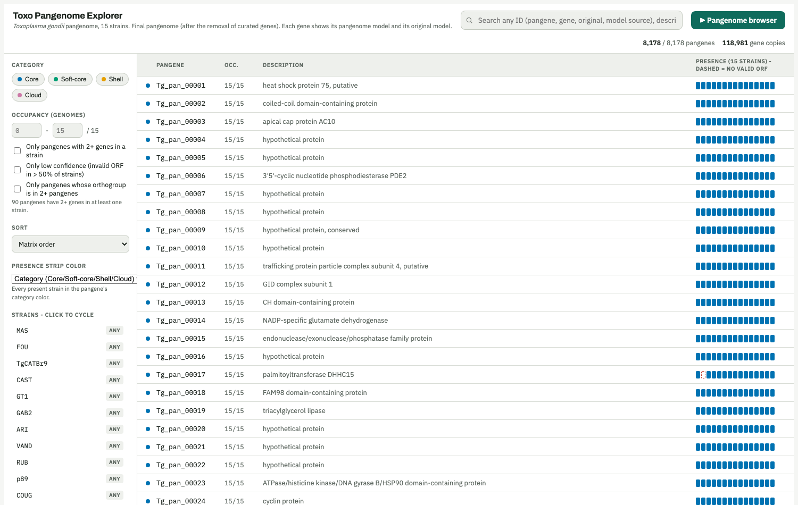

The page opens on the list of all pangenes. The counts at the top right say how many pangenes (and gene copies) the
current filters show. Each row is one pangene:

- **Pangene**: its ID, with a dot in the colour of its category.
- **Occ.**: its occupancy. `9+6?/15` means present in 9 strains, and absent from 6 where the absence may be only an
  assembly problem (shown as `?` boxes in the strip).
- **Description**: the description of its genes.
- **Presence strip**: one small box per strain, in the order of the strain list on the left. A filled box means the
  strain has the gene; a grey box means it does not; a dashed box means the strain's gene has no valid ORF. Hover a
  box to see the strain.

Click a row to open the pangene.

[↑ Back to top](#pangenome-explorer--user-guide) &nbsp;|&nbsp; [Back to the step 07 README](../README.md)

## Searching

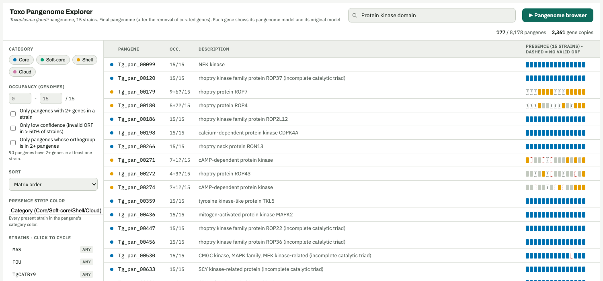

The search box at the top finds pangenes by:

- pangene ID (`Tg_pan_01197`);
- gene ID, in any strain (`Tg1g00757`), or the strain's original gene ID (`TGME49_318700`);
- description (`initiation factor`);
- protein domain: InterPro or Pfam ID, or its name (`IPR000719`, `Protein kinase domain`);
- orthogroup (`OG8_0004823`, for *T. gondii*).

Here, `Protein kinase domain` lists the 177 pangenes with that domain.

A gene in no pangene is found too (by its gene ID, original ID or panel gene, e.g. `TGME49_500178`): the search lists
the pangene next to it, and opening that pangene puts the frame of the locus view on the gene itself (see
[The locus view](#the-locus-view)).

[↑ Back to top](#pangenome-explorer--user-guide) &nbsp;|&nbsp; [Back to the step 07 README](../README.md)

## Filters

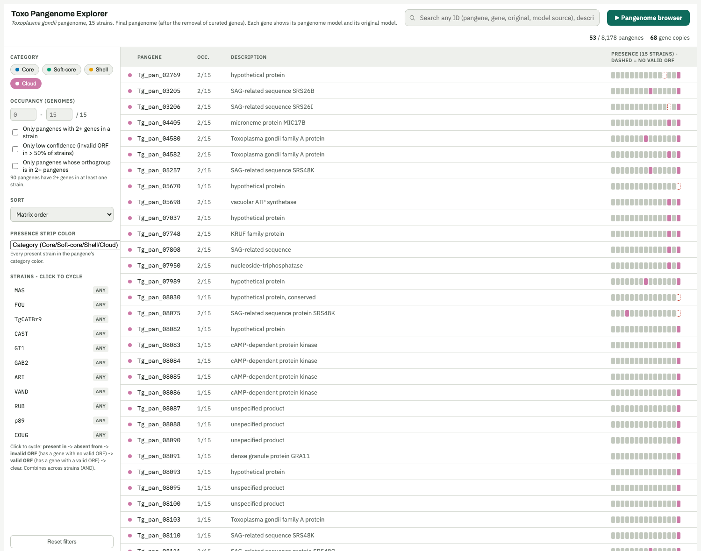

The panel on the left narrows the list. Filters combine: a pangene must pass all of them.

- **Category**: click Core, Soft-core, Shell or Cloud. Here, only the cloud.
- **Occupancy**: a range of strains, e.g. 2–5.
- **Only pangenes with 2+ genes in a strain**: pangenes where a strain has two or more copies.
- **Only low confidence**: pangenes whose gene has no valid ORF in more than half of the strains.
- **Only pangenes whose orthogroup is in 2+ pangenes**: genes that the orthology database groups together but that
  sit at different places in the genomes.
- **Sort**: matrix order (along the chromosomes), occupancy, or pangene ID.
- **Presence strip color**: the category (default), or how well the gene was transferred to each strain (Liftoff
  coverage or identity).
- **Strains – click to cycle**: click a strain to keep only the pangenes **present in** it; click again for **absent
  from**; again for **invalid ORF** (its gene has no valid ORF) or **valid ORF** (its gene has one); once more to clear.
  In the screenshot, the cloud pangenes present in RH88 and absent from ME49 (53 pangenes).
- **Reset filters** clears everything.

[↑ Back to top](#pangenome-explorer--user-guide) &nbsp;|&nbsp; [Back to the step 07 README](../README.md)

## A pangene

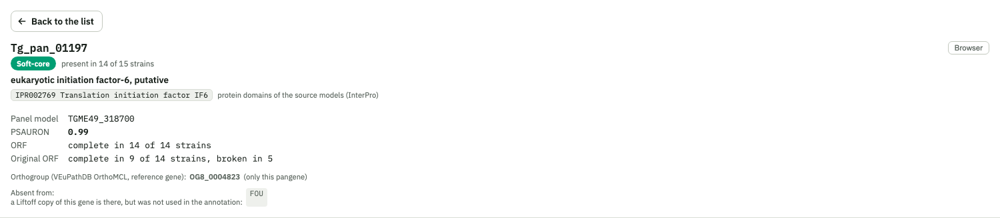

Clicking a pangene opens its page. At the top:

- its ID, category and occupancy;
- the **description**, and the **protein domains** (InterPro). The domains were found in the protein of the model the
  genes come from (the panel model or another strain's model), not separately in each strain's gene;
- **Genes near this pangene that are in no pangene**, when there are any: one line per panel gene, with the reason
  (green square: left out by get_pangenes; red: excluded from the pangenome) and a link to each gene's page;
- **Panel model**: the gene(s) whose model the pangene carries, with how many genes come from each;
- **PSAURON**: a score from 0 to 1 of how much the panel model's protein looks like a real protein (below 0.5, shown in
  red, is doubtful);
- **ORF**: in how many strains the gene has a valid ORF;
- **Original ORF**: the same for the strains' original annotation, and in how many strains the gene was not annotated
  at all;
- **Orthogroup** (*T. gondii*): the VEuPathDB OrthoMCL group of the reference gene; "show them in the browser" shows
  every pangene of that orthogroup side by side;
- **Absent from**: the strains without the gene, grouped by why (e.g. the place is at the end of a contig; another gene
  is in its place; the region is missing). A "?" means the absence may be only an assembly problem.

**Back to the list** (top left) returns to the list. **Browser** (top right) opens the pangene in
the [pangenome browser](#the-pangenome-browser). The top of the page scrolls away with the rest, to leave room for the
drawing.

[↑ Back to top](#pangenome-explorer--user-guide) &nbsp;|&nbsp; [Back to the step 07 README](../README.md)

## The locus view

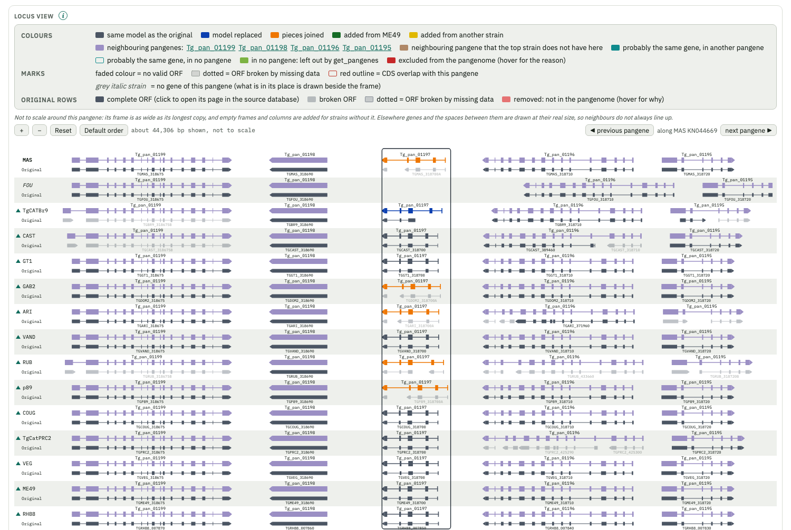

The locus view draws the pangene and its neighbouring genes in every strain, one row per strain. The **(i)** next to
its title shows or hides a short text on how to read and use it.

The **legend** above the drawing is the same for every pangene, in three rows:

- **Colours**, of the strains' genes:
  - this pangene's model in each strain: **same model as the original** (dark grey), **model replaced** (blue: the
    strain's own model was replaced), **pieces joined** (orange: two or more original genes are now one gene), **added
    from ME49** or **added from another strain** (green, yellow: the strain had no gene there in its original
    annotation);
  - **neighbouring pangenes** (lilac), with links to them; **brown**, a neighbouring pangene that the top strain does
    not have at that place; **teal**, probably the same gene as this pangene, but in another pangene (an outline only:
    in no pangene);
  - **in no pangene: left out by get_pangenes** (light green): a gene too short for get_pangenes;
  - **excluded from the pangenome** (red, *T. gondii*): e.g. the mitochondrial genes; hover one for the reason;
  - **TEs** (pink, *A. fumigatus*): the transposable elements (see below).
- **Marks**: **faded colour** = no valid ORF; **dotted** = ORF broken by missing data (an N in the coding sequence, or
  the gene cut by a contig end; hover or open the gene to see which); **red outline** = a CDS overlap with this
  pangene; **grey italic strain** = the strain has no gene of this pangene.
- **Original rows**, under each strain: the strain's original annotation at the same place, in grey: complete ORF,
  broken ORF (pale), dotted (missing data), and **removed** (pink: a gene of the original annotation that is not in the
  pangenome; hover it for the reason, e.g. a false gene removed during curation).

**The frame** in the middle holds this pangene. **Strains without the pangene** have their names in grey italics;
their part of the frame is empty, and what they have in that place is drawn beside it. Hover the strain name for the
reason. Genes are drawn as boxes (coding exons) joined by lines (introns), with an arrow for the strand.

**Genes in no pangene.** When the page is opened for a gene in no pangene (from the search, or from its gene page),
the frame goes around that gene instead, in its colour, with a warning above it. Here, `TGME49_500178`, too short for
get_pangenes, in all 15 strains:

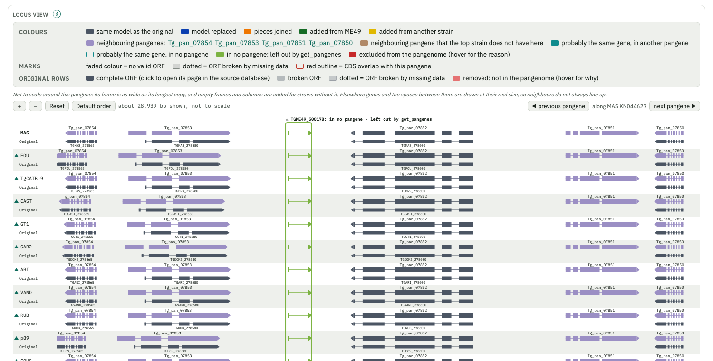

**Genes excluded from the pangenome** are drawn in **red** in the gene rows. They are real sequences but are not
counted in the pangenome, for example the pieces of the mitochondrial genome inserted in the *T. gondii* nuclear
genome (here, next to a core pangene in every strain). Hover one for the reason.

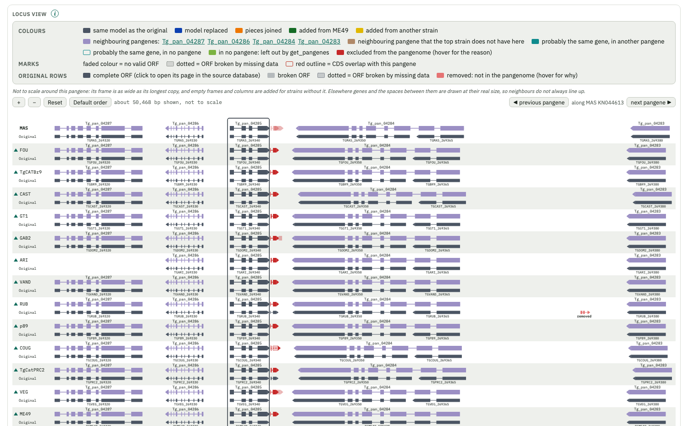

**Transposable elements** (*A. fumigatus* only): under each strain, a **TEs** line shows the transposable elements
found by RepeatMasker in the region, in pink, named by their family. A TE never covers the pangene's frame: it is cut
at the frame's edge. Hover a TE for its family, class and position.

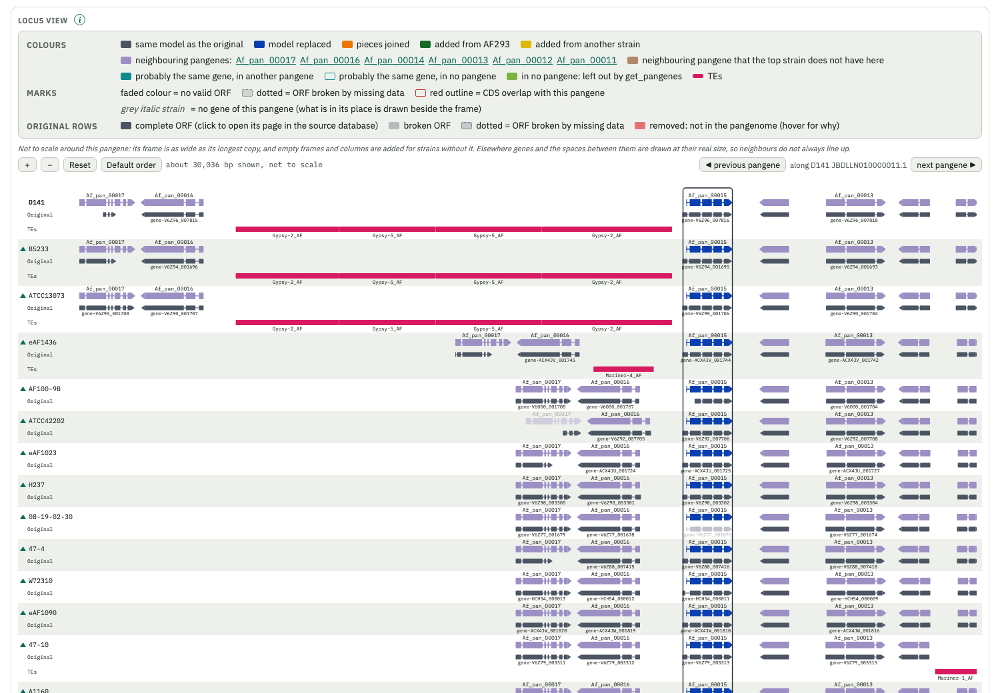

Here (`Af_pan_00015`, *A. fumigatus*), a block of Gypsy retrotransposons sits between the genes in some strains (D141,
B5233 and ATCC13073 at the top) and is missing from the others, which explains why the neighbouring genes are further
apart in those strains.

How to use it:

- **Hover** any gene or original model for its details (IDs, position, ORF).
- **Click** a gene (genes in no pangene included) to open its [gene page](#the-gene-page); click an original model to
  open its page in the source database (ToxoDB, FungiDB), where there is one.
- **Zoom** with **+** / **−** or the mouse wheel; **drag** to move; **Reset** to go back.
- **Move a strain to the top**: click the arrow left of its name. The top strain is drawn as on its chromosome, and the
  others are turned to match it. **Default order** restores the order.
- **◀ previous pangene / next pangene ▶** open the neighbouring pangene, along the top strain's contig.

The drawing is not to scale around the pangene (its frame is as wide as its longest copy); elsewhere the genes and the
spaces between them are drawn at their real size.

[↑ Back to top](#pangenome-explorer--user-guide) &nbsp;|&nbsp; [Back to the step 07 README](../README.md)

## The genes of each strain

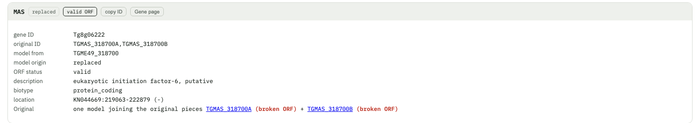

Under the locus view there is one card per strain (two or more if the strain has several copies). The header shows the
strain, how its model was obtained, whether its ORF is valid, and two buttons: **copy ID** and **Gene page**. The card
lists:

| Field | Meaning |
|---|---|
| gene ID | the gene's ID in the pangenome annotation |
| original ID | the strain's own gene ID, when the strain had the gene in its original annotation |
| model from | the gene whose model this strain carries |
| model origin | how the model was obtained (see below) |
| ORF status | `valid`; `invalid`; `invalid_assembly_gap` (N in the coding sequence); `invalid_near_contig_end`; `pseudogene` |
| location | contig, start, end and strand |
| Original | how the model compares with the original annotation (same model, model updated, pieces joined, not annotated), with a link to the original gene |

**Model origin:**

| Value | Meaning |
|---|---|
| `original` | the strain's own gene, kept as it was |
| `replaced` | the strain had the gene, but its model was replaced by a better one transferred from another strain |
| `filled` | the strain had no gene here; the model was transferred from another strain |
| `alternative` | as `filled`/`replaced`, but with the model of another strain that fits this strain better than the panel model |
| `rescued` | a transferred model with a valid ORF that covers only part (50–70%) of the panel gene |
| `target_invalid_orf` | no transferred model has a valid ORF in this strain; the best one is kept, with its broken ORF |
| `repaired_miniprot` | a broken model repaired by aligning the protein to the genome |

[↑ Back to top](#pangenome-explorer--user-guide) &nbsp;|&nbsp; [Back to the step 07 README](../README.md)

## The gene page

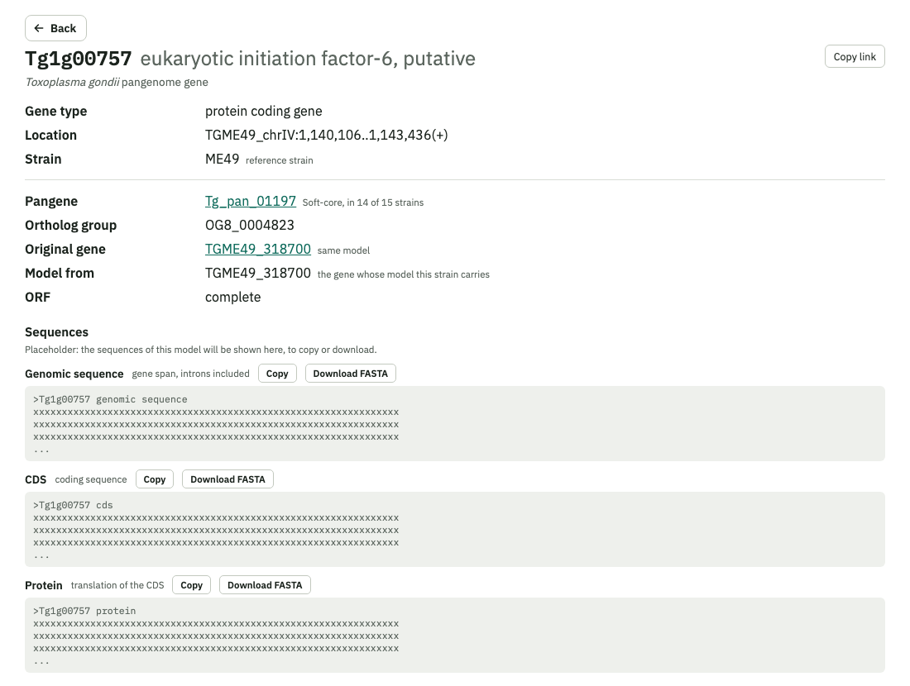

The gene page (button **Gene page**, or a click on a gene in the locus view) shows one gene: its type, location,
strain, pangene (click to go to it), orthogroup, original gene, the model it carries, and its ORF (with the cause when
it is broken by missing data: assembly gap or contig end). For a gene in no pangene, the pangene line says so, with
the reason and a link to the pangene next to it. **Copy link** copies
a link that opens the page directly on this gene. The sequence section is a placeholder: the genomic, coding and
protein sequences are not linked yet, because they would make the file too large to share as one page.

[↑ Back to top](#pangenome-explorer--user-guide) &nbsp;|&nbsp; [Back to the step 07 README](../README.md)

## The pangenome browser

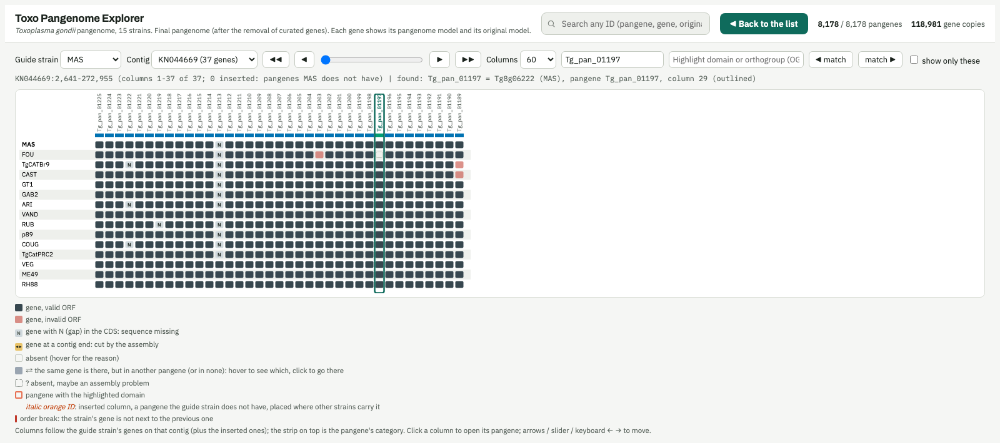

**▶ Pangenome browser** (top right of the list) shows many pangenes at once, along a chromosome:

- choose a **guide strain** and a **contig**: each column is one gene of the guide strain, in its order along the
  contig, with the pangene's category as a coloured bar on top and its ID above;
- each row is a strain: a dark cell means the strain has the gene with a valid ORF; red, an invalid ORF; **N**, an
  assembly gap in the gene; a yellow cell, a gene cut at a contig end; an empty cell, the gene is absent (hover for the
  reason; "?" = maybe an assembly problem); a grey cell with ⇄, the same gene is there but in another pangene;
- a red bar between cells marks an order break: the strain's gene is not next to the previous one (a rearrangement or
  an assembly break);
- **inserted columns** (italic orange IDs) are pangenes the guide strain does not have, placed where the other strains
  carry them;
- move with the arrows, the slider, or the keyboard (← →); **Columns** sets how many are shown;
- **Go to**: type a pangene, gene or original ID to jump to it (outlined in green, as `Tg_pan_01197` here);
- click a column to open its pangene.

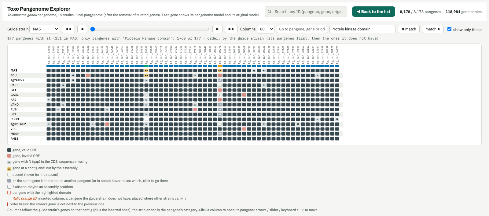

**Highlight domain or orthogroup**: type an InterPro/Pfam ID or name, or an orthogroup. The columns whose pangene has it
are outlined, and **◀ match / match ▶** jump to the previous or next one. With **show only these**, the browser shows
only those pangenes, side by side: first the guide strain's, in its order, then the ones it does not have. Here, the
177 pangenes with a protein kinase domain.

[↑ Back to top](#pangenome-explorer--user-guide) &nbsp;|&nbsp; [Back to the step 07 README](../README.md)

## Links to a pangene or a gene

The address of the page can open it directly on a pangene or a gene: add `#pangene=Tg_pan_01197` or `#gene=Tg1g00757`
to the end of the file's address. **Copy link** on the gene page gives such a link.

[↑ Back to top](#pangenome-explorer--user-guide) &nbsp;|&nbsp; [Back to the step 07 README](../README.md)
