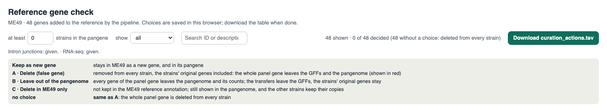
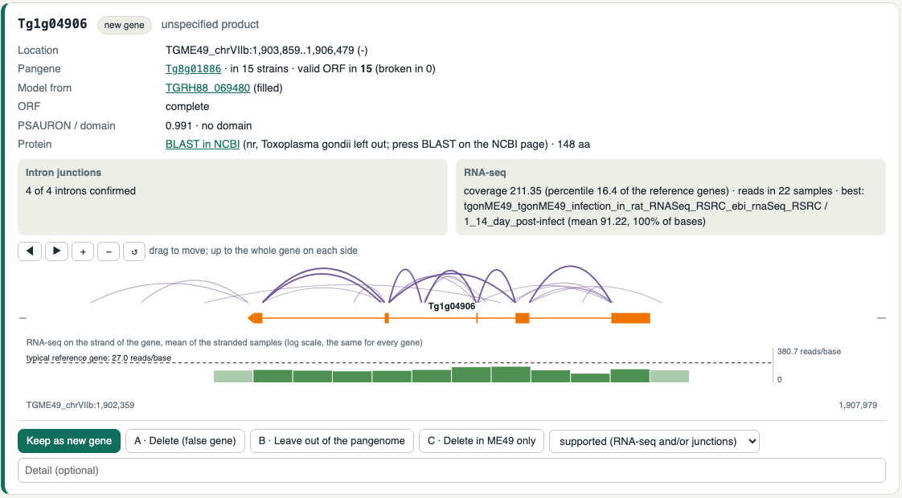
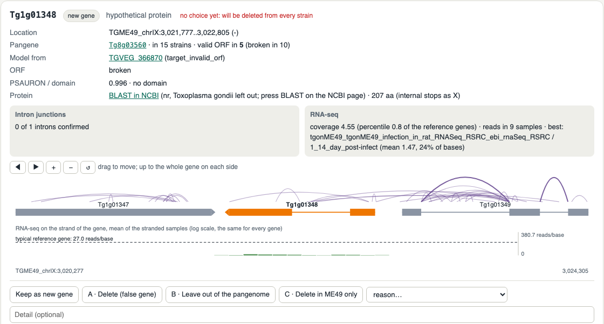

# Reference gene check – user guide

[← Back to the step 07 README](../README.md)

> **Under construction.** This page is a first help to look at the genes that the pipeline added to the reference
> genome. The best place to check a gene is still the genome browser (JBrowse) of VEuPathDB (ToxoDB, FungiDB), with all
> its tracks. The page can be improved in the future to help confirm the new genes, e.g. with more evidence.

The pipeline transfers genes between strains, so the reference genome (*T. gondii* ME49, *A. fumigatus* AF293) can
receive genes it did not have in its annotation. These **new genes** need a decision, gene by gene: are they real?
The page `reference_check/reference_check.html` shows each new gene with its evidence, and records a choice for each.
The screenshots are from *T. gondii* ME49 (48 new genes).

## Contents

- [Opening the page](#opening-the-page)
- [The top of the page](#the-top-of-the-page)
- [A new gene](#a-new-gene)
- [The evidence](#the-evidence)
- [Making a choice](#making-a-choice)
- [Saving the choices](#saving-the-choices)

[↑ Back to top](#reference-gene-check--user-guide) &nbsp;|&nbsp; [Back to the step 07 README](../README.md)

## Opening the page

Double-click `reference_check.html`. It opens in your web browser and needs no installation; the BLAST links need an
internet connection.

[↑ Back to top](#reference-gene-check--user-guide) &nbsp;|&nbsp; [Back to the step 07 README](../README.md)

## The top of the page

- **at least _n_ strains in the pangene**: show only the new genes whose pangene is in that many strains or more.
- **show**: all genes, only those without a choice, or only those already decided.
- **Search**: a gene ID or a word of the description.
- **protein outside the species** (only when the page was built with a protein search): genes with or without a
  protein hit in other species.
- The counts on the right: how many genes are shown, and how many are decided.
- **Download curation_actions.tsv**: the table of all choices (see [Saving the choices](#saving-the-choices)).
- The grey box explains what each choice does.

[↑ Back to top](#reference-gene-check--user-guide) &nbsp;|&nbsp; [Back to the step 07 README](../README.md)

## A new gene

Each new gene has a card:

| Field | Meaning |
|---|---|
| ID, description | the gene's ID in the pangenome annotation and its description |
| Location | contig, start, end and strand in the reference |
| Pangene | its pangene (link to the explorer), in how many strains, and in how many of them the gene has a valid ORF |
| Model from | the strain gene whose model was transferred to the reference, and how (e.g. `filled`: the reference had no gene here) |
| ORF | complete or broken (and why: assembly gap, contig end) |
| PSAURON / domain | how much the protein looks like a real protein (0 to 1; below 0.5 is doubtful), and whether it has an InterPro domain |
| Protein | **BLAST in NCBI** opens NCBI blastp with the protein already filled in, against nr, with the species itself left out, so a hit is evidence from another species. The search starts only when BLAST is pressed on the NCBI page. A broken ORF is translated with its internal stops written as X. |

[↑ Back to top](#reference-gene-check--user-guide) &nbsp;|&nbsp; [Back to the step 07 README](../README.md)

## The evidence

The drawing shows the gene (orange) with the reference genes around it (grey):

- **Intron junctions** (purple arcs, from VEuPathDB's RNA-seq intron junctions): each arc joins the two ends of an
  intron seen in the RNA-seq reads. A higher arc has more reads; a dark, thick arc is a strong junction, a faint one a
  weak junction. The box above says how many of the gene's introns a junction confirms.
- **RNA-seq** (green bars, from VEuPathDB's RNA-seq datasets): the reads on the gene's own strand, in 10 parts along
  the gene, plus the regions just before and after (paler). The scale is the same for every gene, and the dashed line
  is a typical reference gene. The box above gives the coverage, its percentile among the reference's own genes, in
  how many samples there are reads, and the best sample.
- **◀ ▶ + − ↺**: move and zoom the drawing (up to the whole neighbouring gene on each side); drag to move.

In the first example above (`Tg1g04906`), the 4 introns are confirmed by junctions and the RNA-seq covers the whole
gene, close to a typical reference gene. The next example has little support:

Here (`Tg1g01348`), no intron is confirmed, the RNA-seq is very low (percentile 0.8), the ORF is broken, and the gene
has a valid ORF in only 5 of the 15 strains.

Little or no RNA-seq does not prove a gene false: a gene can be expressed only in conditions not sampled. The page
only gathers the evidence; the decision is a judgement, best made together with the genome browser of VEuPathDB.

[↑ Back to top](#reference-gene-check--user-guide) &nbsp;|&nbsp; [Back to the step 07 README](../README.md)

## Making a choice

Under each gene, one of four choices, a reason from the list, and an optional free-text detail:

| Choice | What happens to the gene |
|---|---|
| **Keep as new gene** | stays in the reference as a new gene, and in its pangene |
| **A · Delete (false gene)** | removed from every strain, the strains' original genes included: the whole panel gene leaves the annotation and the pangenome |
| **B · Leave out of the pangenome** | every gene of the panel gene leaves the pangenome and its counts, but stays in the annotation (e.g. mitochondrial genes) |
| **C · Delete in the reference only** | in the pangenome, the same as Keep: the gene stays in its pangene and the other strains keep their copies. It is only marked as not wanted in the reference annotation (tag `reference_excluded` and the list `reference_excluded.tsv`), so that the final reference GFF ([step 08](../../08_Final_GFF/README.md)) leaves it out |
| no choice | the same as A: the whole panel gene is deleted from every strain |

**Reasons:** supported (RNA-seq and/or junctions); no support (no RNA-seq, no junctions); mitochondrial gene; model to
fix; extra copy / gene family; overlaps a reference gene; other.

A gene with a choice gets a coloured border, and its choice button stays highlighted.

[↑ Back to top](#reference-gene-check--user-guide) &nbsp;|&nbsp; [Back to the step 07 README](../README.md)

## Saving the choices

The choices are kept in your web browser only (on this computer, in this browser). When you are done, press
**Download curation_actions.tsv**: the table has every gene, its choice, reason and detail. Send it to the person who
runs the pipeline, who applies it in the removal step (step 07, part 4), in one of two ways:

- **The table itself:** saved as `07_Post_GET_PANGENES_adjusting/curation_actions.tsv`, it is read by
  `remove_panel_genes_job.sh` on its own (the log says `curation actions: ...`): A and no choice → the whole panel gene
  is deleted; B → left out of the pangenome; C → tagged for the final reference GFF; Keep → nothing.
- **By hand:** the decisions are written in the lists of part 4 (`genes_to_remove.tsv`,
  `genes_to_exclude_from_pangenome.tsv`), and the job is run with `ACTIONS=` so that no table is read. This is the way
  when the decisions were changed after the page (e.g. discussed with the group), or when more genes than those of
  the page must be removed.

Before using the table, check two things: it must come from the page of the same run (it is matched by panel gene, so
a table from another run can point to other genes), and every gene must have the choice wanted, since a gene with no
choice is deleted.

[↑ Back to top](#reference-gene-check--user-guide) &nbsp;|&nbsp; [Back to the step 07 README](../README.md)
