# Get_PanLoci 

***Purpose***: This document describes a pipeline to build a non-redundant catalogue of
panloci across multiple *Plasmodium falciparum* genomes and to infer
presence/absence/partial variation for each locus in each strain.
***Definition***:

In this pipeline, a **panlocus** is a genomic locus represented by DNA coordinates.
Each panlocus originates from an annotated locus (a protein-coding gene or pseudogene) in at least one strain (the origin/donor strain). However, in any given target strain, a panlocus is **not necessarily an annotated gene** (or even annotated at all).

Using whole-genome alignments generated by Cactus, the pipeline transfers the orthologous DNA coordinates across genomes using `halLiftover`. This projects the homologous genomic interval to other strains regardless of whether those strains have an annotated gene model at that location. The transferred DNA regions are then independently validated at the sequence level using `minimap2`.

This distinction is crucial because:
- A panlocus is not restricted to strictly protein-coding or confidently expressed genes in every strain.
- Homologous genomic regions are tracked across strains even if a strain lacks annotation, has an unannotated region, or annotates the locus as a pseudogene.
- Annotated genes from each strain are evaluated sequentially and added as novel panloci only when they are not already represented by an existing panlocus.

## Aim

The goal is to produce:

- a non-redundant panlocus catalogue;
- transferred coordinates for each panlocus in each genome when available;
- real DNA validation metrics for each transferred locus;
- a final PAV table with `PRESENT`, `PARTIAL`, and `ABSENT` calls;
- review tables that preserve complex annotation events such as split or fused
  native gene models.

The method is designed for situations where annotation quality differs among
assemblies. It does not require every genome to have a perfect annotation. A
strain without annotation can still receive panloci transferred from annotated
strains, but it cannot contribute new panloci.

## Simplified Workflow

```mermaid
flowchart LR
    inputs["Inputs<br/>genomes_all.txt<br/>samples.tsv<br/>FASTA files<br/>GFF files"]
    cactus["Step 0<br/>Cactus pangenome<br/>build whole-genome HAL"]
    seed["Step 1<br/>Seed strain<br/>extract CDS-span/pseudogene intervals"]
    liftover_seed["halLiftover<br/>transfer seed panloci<br/>to target genomes"]
    validate["Step 2<br/>minimap2 DNA validation"]
    thresholds["Validation thresholds<br/>PRESENT: coverage >= 0.50 and identity >= 50<br/>PARTIAL: coverage >= 0.30 and identity >= 30<br/>ABSENT: otherwise"]
    classify["Classify calls<br/>PRESENT / PARTIAL / ABSENT"]
    nextstrain["Step 3<br/>Sequential catalogue expansion<br/>current annotated strain"]
    overlap{"Native gene overlaps<br/>an existing panlocus?<br/>minimum overlap >= 0.50"}
    represented["Already represented<br/>update evidence and call<br/>no new transfer"]
    novel["Novel panlocus<br/>add native gene to catalogue"]
    liftover_novel["halLiftover<br/>transfer novel panlocus<br/>to other genomes"]
    validate_novel["minimap2 validation<br/>classify novel transfer"]
    continue_loop["Continue loop<br/>next native gene<br/>or next annotated strain"]
    outputs["Final outputs<br/>panlocus catalogue<br/>long evidence table<br/>PAV matrix<br/>review flags"]

    inputs --> cactus --> seed --> liftover_seed --> validate --> thresholds --> classify
    classify --> nextstrain
    nextstrain --> overlap
    overlap -->|"yes"| represented
    overlap -->|"no"| novel
    represented --> continue_loop
    novel --> liftover_novel --> validate_novel --> continue_loop
    continue_loop --> nextstrain
    classify --> outputs
    continue_loop --> outputs
```



The first pass starts from the seed strain defined by `analysis_order = 1` in
`samples.tsv`. After seed panloci are transferred and validated, the catalogue
is expanded sequentially through the remaining annotated strains. At each
iteration, native genes that overlap existing panloci only update the evidence
and final call for the current strain. They are not transferred again and do not
create a new panlocus. Native genes that do not overlap existing panloci at the
configured cutoff are added as novel panloci, transferred to the other genomes,
validated, and then included in the final catalogue. The loop continues until
all annotated strains have been evaluated.

## Main Assumptions

- Step 0 builds the Cactus HAL alignment from the genome list.
- Steps 1-3 use the HAL file produced by Step 0, or an equivalent HAL file from
  a previous Cactus run.
- The `strain_id` values in `samples.tsv` exactly match the genome names used
  in the HAL file.
- FASTA files in `samples.tsv` correspond to the same genome versions used to
  build the HAL alignment.
- GFF files use consistent sequence names with the corresponding FASTA files.
- For annotated strains, the GFF must contain one main feature for each annotated locus.
- The main feature can be:
  - `gene`
  - `protein_coding_gene`
  - `pseudogene`
- For coding loci (`gene` or `protein_coding_gene` with CDS annotation), the GFF should contain `CDS` features linked back to the corresponding main feature. These CDS records are used to calculate CDS-span coordinates.
- For pseudogenes, CDS records are not required. The pipeline uses the full annotated `pseudogene` feature span.

## Dependencies

Required:

- Bash (Linux/macOS)
- SLURM (optional; required only when using the scripts in `scripts/` on an HPC cluster)
- Python 3.8 or newer
  - only Python standard-library modules are used
  - FASTA sequence extraction is performed internally by the Python scripts
- Apptainer / Singularity container environment (or local installations of Cactus and minimap2)
- [Cactus pangenome/minigraph](https://github.com/ComparativeGenomicsToolkit/cactus/blob/master/doc/pangenome.md) container or installation, including:
  - `cactus-pangenome`
  - `halLiftover`
  - `minimap2`
- Standard Unix tools (`grep`, `awk`, `sed`, `sort`, `bedtools` if used externally)

## Script Directories & Execution Modes

The repository contains two script directories tailored for different environments:

- **`scripts/` (SLURM / HPC Cluster)**:
  - [`scripts/step0_run_cactus_pangenome.slurm`](scripts/step0_run_cactus_pangenome.slurm): SLURM batch job script to construct the Cactus HAL alignment.
  - [`scripts/run_get_panloci.slurm`](scripts/run_get_panloci.slurm): SLURM batch orchestrator running Steps 1, 2, and 3 sequentially.
  - [`scripts/step1_prepare_seed_transfers.py`](scripts/step1_prepare_seed_transfers.py): Step 1 Python script (seed coordinate extraction and `halLiftover`).
  - [`scripts/step2_validate_transfers.py`](scripts/step2_validate_transfers.py): Step 2 Python script (`minimap2` DNA validation).
  - [`scripts/step3_build_panlocus_catalogue.py`](scripts/step3_build_panlocus_catalogue.py): Step 3 Python script (sequential catalogue expansion and PAV matrix generation).
  - [`scripts/panloci_common.py`](scripts/panloci_common.py): helpers the three step scripts share (samples.tsv, GFF/FASTA reading, halLiftover merging). Copy it into `RUN_DIR` with them.

- **`scripts_no_slurm/` (Direct Bash / Non-SLURM Servers & Workstations)**:
  - [`scripts_no_slurm/step0_run_cactus_pangenome.sh`](scripts_no_slurm/step0_run_cactus_pangenome.sh): Direct Bash script to construct the Cactus HAL alignment.
  - [`scripts_no_slurm/run_get_panloci.sh`](scripts_no_slurm/run_get_panloci.sh): Direct Bash orchestrator running Steps 1, 2, and 3 sequentially.
  - The Step 1–3 Python scripts are not duplicated here: use the ones in [`scripts/`](scripts/) (copy them and `panloci_common.py` into `RUN_DIR`, as for the SLURM version).
  - [`scripts_no_slurm/README_get_panloci.md`](scripts_no_slurm/README_get_panloci.md): Dedicated guide for non-SLURM execution.

Both versions run the exact same Python scripts (from `scripts/`), with the same command-line arguments and output structures.

## Inputs

### Genome List for Cactus

Step 0 uses a genome list to build the Cactus pangenome alignment:

```text
genomes_all.txt
```

Expected format:

```text
strain_id<TAB>/absolute/path/to/genome.fasta
```

The `strain_id` values in this file must match the names later used in
`samples.tsv`.

### Cactus HAL Alignment

Step 0 generates the main HAL file:

```text
OUT_DIR/OUT_NAME.full.hal
```

This `.full.hal` file is then used by Steps 1 and 3 through the `PANGENOME_HAL`
variable in `scripts/run_get_panloci.slurm` or `scripts_no_slurm/run_get_panloci.sh`.

If a suitable Cactus HAL alignment was already generated in a previous run, Step
0 can be skipped and the existing `.full.hal` path can be supplied directly as
`PANGENOME_HAL`.

Other Cactus outputs such as VCF, GFA, GBZ, or visualization files can be useful
for other analyses, but they are not the main input for this panlocus catalogue
pipeline.

### Sample Table

The main metadata file is `samples.tsv`.

Required columns:

```text
strain_id
genome_fasta
annotation_gff
analysis_order
```

Column meanings:

- `strain_id`: strain name exactly as used in the HAL alignment.
- `genome_fasta`: path to the genome FASTA file.
- `annotation_gff`: path to a GFF/GFF3 file, path to a directory containing one
  GFF/GFF3 file, or `NA`.
- `analysis_order`: order used by the sequential catalogue expansion.

Important rules:

- The strain with `analysis_order = 1` is the seed strain.
- Annotated strains can add new panloci during Step 3.
- Strains with `annotation_gff = NA` cannot add new panloci, but they are still
  evaluated for panlocus presence using coordinate transfer and DNA validation.
- If two runs use different seed strains or different order, the final catalogue
  should be compared carefully because sequential catalogue construction can
  expose annotation and assembly differences.

### GFF Requirements

For annotated strains, the GFF/GFF3 file is used to define native panlocus
coordinates. The script reads these feature types:

```text
gene
protein_coding_gene
pseudogene
mRNA
transcript
CDS
```

The GFF must contain one gene-level feature per annotated locus. Accepted
gene-level feature types are:

```text
gene
protein_coding_gene
pseudogene
```

For protein-coding loci, the GFF should also contain `CDS` records linked to the
gene. The link can be direct (via `gene_id` or direct `Parent` attribute pointing to the gene ID):

```text
chr1  source  gene  1000  5000  .  +  .  ID=GeneA
chr1  source  CDS   1200  1500  .  +  0  ID=cds1;gene_id=GeneA
chr1  source  CDS   2000  2500  .  +  0  ID=cds2;gene_id=GeneA
```

or direct parentage:

```text
chr1  source  gene  1000  5000  .  +  .  ID=GeneA
chr1  source  CDS   1200  1500  .  +  0  ID=cds1;Parent=GeneA
chr1  source  CDS   2000  2500  .  +  0  ID=cds2;Parent=GeneA
```

or indirect through an `mRNA` or `transcript` feature:

```text
chr1  source  gene  1000  5000  .  +  .  ID=GeneA
chr1  source  mRNA  1000  5000  .  +  .  ID=GeneA.1;Parent=GeneA
chr1  source  CDS   1200  1500  .  +  0  ID=cds1;Parent=GeneA.1
chr1  source  CDS   2000  2500  .  +  0  ID=cds2;Parent=GeneA.1
```

In both examples, the CDS-span for `GeneA` is:

```text
1200-2500
```

The full gene span is:

```text
1000-5000
```

The pipeline uses CDS-span for protein-coding genes to avoid comparing
different annotation conventions as if they were biological differences. For
example, one strain may annotate a gene with UTRs, while another strain may
annotate only the coding sequence. If the full gene span were used, the same
gene could appear artificially longer in the strain with UTR annotation. Using
CDS-span makes the coordinate definition more consistent across annotations.

Only one transcript is used per protein-coding gene. If a gene has multiple
`mRNA` or `transcript` records, the pipeline selects one representative
transcript: the transcript with the largest total CDS length. This creates one
panlocus interval per gene instead of multiple intervals for alternative
transcripts.

Coordinate extraction rules:

- Protein-coding gene-like features are represented by CDS span.
- CDS span means the interval from the first CDS base to the last CDS base of
  the selected transcript.
- If multiple transcripts are present, only one representative transcript is
  used per gene. The selected transcript is the one with the largest total CDS
  length. Ties are resolved deterministically by transcript ID.
- Pseudogenes are represented by the full annotated pseudogene feature span.
- If a protein-coding gene-like feature has no CDS record that can be linked
  back to the gene, the original gene feature span is used and the event is
  recorded in an audit table.

Pseudogene example:

```text
chr1  source  pseudogene  7000  8200  .  -  .  ID=PseudoGeneA
```

For this locus, the pipeline uses:

```text
7000-8200
```

because pseudogenes are represented by their annotated feature span, not by CDS
span.

After extraction, check:

```text
candidate_transfers/qc/*_cds_span_annotation_audit.tsv
```

This table reports whether each locus used CDS-span, pseudogene span, or the
original gene feature span because no CDS was found.

## Outputs Overview

The pipeline creates three main output areas:

```text
prepared_inputs/
candidate_transfers/
validation/
panlocus_catalogue/
```

Their roles are:
- `prepared_inputs/`: standardized and quality-checked inputs from step0,
  including renamed FASTA files, FASTA indexes, genome metadata, chromosome
  name maps, and input QC summaries.
- `candidate_transfers/`: coordinate transfer candidates from `halLiftover`.
- `validation/`: minimap2 validation of transferred seed panloci.
- `panlocus_catalogue/`: final panlocus catalogue, final PAV matrix, evidence
  table, review flags, and novel candidate summaries.

## Step 0: Build the Cactus Pangenome Alignment

Script:

```text
scripts/step0_run_cactus_pangenome.slurm         # SLURM execution
# or
scripts_no_slurm/step0_run_cactus_pangenome.sh   # Direct Bash execution
```

Purpose:

Step 0 builds the whole-genome pangenome alignment with Cactus. This is the
alignment used later for coordinate transfer with `halLiftover`.

This step is computationally expensive and should normally be run as its own
SLURM job. The downstream panlocus steps can be run only after the Cactus HAL
file has been generated successfully.

Input genome list:

```text
genomes_all.txt
```

Expected format:

```text
strain_id<TAB>/absolute/path/to/genome.fasta
```

The `strain_id` values in `genomes_all.txt` must match the names used later in
`samples.tsv`.

Main Cactus output:

```text
OUT_DIR/OUT_NAME.full.hal
```

The HAL file stores the whole-genome alignment used by `halLiftover` to project
coordinates from one strain to another.

Other useful Cactus outputs requested by the current Step 0 script:

```text
OUT_NAME.vcf.gz
OUT_NAME.gfa.gz
OUT_NAME.gbz
OUT_NAME.d2.gbz
OUT_NAME.viz
```

The exact set of files depends on the Cactus version and selected options.

Important Step 0 variables:

```text
PROJECT_DIR
GENOMES_FILE
CACTUS_SIF
OUT_DIR
OUT_NAME
JOBSTORE
CACTUS_REFERENCE
MAX_CORES
MAX_MEMORY
APPTAINER_BIND_PATH
CACTUS_EXTRA_OPTIONS
```

Current Cactus options:

```text
--vcf
--giraffe
--gfa
--gbz
--viz
--permissiveContigFilter
```

`--permissiveContigFilter` is used here because some assemblies include shorter
or fragmented contigs, and a permissive contig filter helps retain more input
sequence in the pangenome alignment.

Important distinction:

- The reference used when building the Cactus alignment is a Cactus/graph
  construction choice.
- The seed strain used by this panlocus pipeline is the row with
  `analysis_order = 1` in `samples.tsv`.

These can be the same strain, but they do not have to be. For example, a HAL
file may have been built using `REF3D7` as the Cactus reference, while the
panlocus catalogue can still be seeded from `GN01` if `GN01` has
`analysis_order = 1` in `samples.tsv`.

Recommended checks after Step 0:

- Confirm that `OUT_DIR/OUT_NAME.full.hal` exists.
- Confirm that all intended strains are present in the Cactus genome list.
- Confirm that the strain names in `genomes_all.txt` match `samples.tsv`.
- Check the Cactus log and error files for warnings about skipped or filtered
  contigs.
- Use the final `.full.hal` path as `PANGENOME_HAL` in
  `scripts/run_get_panloci.slurm` or `scripts_no_slurm/run_get_panloci.sh`.

## Step 1: Prepare Seed Panlocus Transfers

Script:

```text
scripts/step1_prepare_seed_transfers.py
```

Purpose:

Step 1 initializes the analysis from the seed strain. It extracts seed
panlocus coordinates from the seed GFF, transfers those coordinates to every
other genome using the HAL alignment, and writes one merged candidate BED file
per target strain.

Inputs:

```text
samples.tsv
PANGENOME.full.hal
seed strain GFF
Cactus/halLiftover executable or Cactus SIF image
```

Analysis:

1. Read `samples.tsv`.
2. Identify the seed strain as the row with `analysis_order = 1`.
3. Find the seed GFF.
4. Extract seed panlocus intervals:
   - protein-coding genes use CDS-span;
   - pseudogenes use pseudogene feature span;
   - genes without CDS use original feature span and are flagged in the audit
     table.
5. Run `halLiftover` from the seed strain to every other strain.
6. Merge fragmented transferred blocks belonging to the same locus.
7. Keep the primary transfer cluster for each locus.
8. Save secondary transfer clusters in a QC table.

Merging rule:

- Raw lifted blocks are grouped by locus.
- Blocks are clustered by target contig and strand.
- Blocks within the configured gap are merged.
- Overlapping segments inside each cluster are merged before calculating the total mapped length. This prevents overinflating base counts or coverage percentages beyond 100% in cases of local duplications.
- The primary cluster is the cluster with the largest total mapped length.
- Secondary clusters are not used for the main PAV call, but are saved for QC.

Default merge gap:

```text
--gap 5000
```

Important outputs:

```text
candidate_transfers/*_seed.bed
candidate_transfers/SEED_to_TARGET_merged.bed
candidate_transfers/raw_liftovers/SEED_to_TARGET_raw.bed
candidate_transfers/qc/multihit_duplicated_loci.tsv
candidate_transfers/qc/SEED_cds_span_annotation_audit.tsv
```

Merged BED columns:

```text
chrom
start
end
name
score
strand
orig_size
lifted_size
percentage
```

Column meanings:

- `chrom`: target chromosome or contig.
- `start`: 0-based start of the merged primary cluster.
- `end`: end coordinate of the merged primary cluster.
- `name`: donor panlocus ID.
- `score`: fixed `0`.
- `strand`: target strand.
- `orig_size`: size of the donor interval.
- `lifted_size`: total number of lifted bases in the selected cluster.
- `percentage`: `lifted_size / orig_size * 100`.

Recommended checks after Step 1:

- Confirm that one `*_seed.bed` file was created.
- Confirm that every expected target has a `SEED_to_TARGET_merged.bed`.
- Inspect `candidate_transfers/qc/multihit_duplicated_loci.tsv` for loci with
  multiple distal hits.
- Inspect `candidate_transfers/qc/SEED_cds_span_annotation_audit.tsv` to verify
  how seed GFF intervals were extracted.

## Step 2: Validate Transferred Seed Panloci

Script:

```text
scripts/step2_validate_transfers.py
```

Purpose:

Step 2 validates whether each transferred seed panlocus is supported by DNA
sequence similarity in each target strain. The HAL transfer proposes a genomic
location; minimap2 checks whether the donor panlocus sequence and target
transferred sequence actually align.

Inputs:

```text
samples.tsv
candidate_transfers/*_seed.bed
candidate_transfers/SEED_to_TARGET_merged.bed
donor and target FASTA files from samples.tsv
minimap2
```

Analysis:

1. Load the seed BED.
2. Load each target merged BED.
3. Extract donor panlocus sequences from the seed FASTA.
4. Extract target sequences from transferred coordinates.
5. Run one permissive batch minimap2 alignment per target strain.
6. Keep alignments where query ID and target ID match the same locus.
7. For loci not recovered in the batch alignment, run isolated 1-to-1 pairwise
   fallback alignment.
8. Classify each locus as `PRESENT`, `PARTIAL`, or `ABSENT`.

Why batch plus fallback is used:

- The batch alignment is efficient because all loci are aligned together.
- In highly similar or repetitive regions, one locus may be missed in the batch
  alignment because a related locus receives the stronger alignment.
- The fallback aligns only the missing locus pair, allowing recovery of loci
  that were missed in the batch step.
- The fallback is only attempted for loci not found in the batch results.

Default minimap2 logic:

```text
batch:    minimap2 -c -N 100 -p 0.1
fallback: minimap2 -c
```

Classification thresholds:

```text
PRESENT:
coverage >= 0.50
and identity >= 50.0

PARTIAL:
coverage >= 0.30
and coverage < 0.50
and identity >= 30.0

ABSENT:
coverage < 0.30
or identity < 30.0
or no valid alignment
```

Command-line parameters:

```text
--present-cov-cutoff
--present-id-cutoff
--partial-cov-cutoff
--partial-id-cutoff
```

Important output:

```text
validation/SEED_to_TARGET.validation.tsv
```

Validation columns:

```text
gene_id
query_length
target_length
alignment_length
query_coverage
percent_identity
validation_status
```

Important interpretation:

- `query_coverage` and `percent_identity` in the validation files are the real
  minimap2-derived validation metrics.
- Use these files when checking individual loci.
- The final PAV matrix is a simplified call table and should not replace the
  validation files for metric-level QC.

Recommended checks after Step 2:

- Confirm that each target has a `.validation.tsv` file.
- Check summaries printed in the log for unexpectedly high `ABSENT` counts.
- Inspect close strains first; they should usually have high `PRESENT` counts.
- Review loci with low identity or low coverage before changing thresholds.

## Step 3: Build Sequential Panlocus Catalogue

Script:

```text
scripts/step3_build_panlocus_catalogue.py
```

Purpose:

Step 3 builds the final non-redundant catalogue. It starts from the seed
panloci, integrates the seed validation evidence, then visits each annotated
strain in `analysis_order`. For each annotated strain, native genes that are
already represented by existing panloci are recorded as evidence. Native genes
not represented by existing panloci become novel panloci and are transferred to
the remaining genomes.

Inputs:

```text
samples.tsv
candidate_transfers/
validation/
PANGENOME.full.hal
all available GFF files
all FASTA files
```

Analysis:

1. Initialize the catalogue using the seed panloci.
2. Mark seed-strain panloci as `PRESENT`.
3. Load Step 2 validation files for seed-to-target transfers.
4. For each annotated strain in `analysis_order`:
   - extract native gene intervals using the same CDS-span/pseudogene-span rule;
   - compare native intervals against already known transferred panloci;
   - record whether native annotation supports existing panloci;
   - identify native genes not represented by any existing panlocus;
   - add those genes as novel panloci;
   - transfer novel panloci to other strains with `halLiftover`;
   - validate novel transfers using minimap2;
   - update the final evidence table.
5. Write final catalogue, final long PAV table, final matrix, and QC tables.

Native annotation BED files:

```text
candidate_transfers/STRAIN_cds_span_gene_pseudogene.bed
```

Native annotation audit files:

```text
candidate_transfers/qc/STRAIN_cds_span_annotation_audit.tsv
```

Novel candidate files:

```text
panlocus_catalogue/iteration_reports/donor_STRAIN_novel_candidates.bed
```

Novel transfer files:

```text
candidate_transfers/DONOR_to_TARGET_novel_merged.bed
candidate_transfers/raw_liftovers/DONOR_to_TARGET_novel_raw.bed
```

### Native Overlap Rule

The native overlap cutoff decides whether an annotated native gene is already
represented by an existing panlocus.

Default:

```text
--native-overlap-cutoff 0.50
```

A native gene and a transferred panlocus are considered related if either:

```text
overlap_fraction_of_native >= 0.50
```

or:

```text
overlap_fraction_of_transfer >= 0.50
```

This two-direction rule is used because annotations can differ among strains.
For example:

- a transferred panlocus can overlap two native genes if the target annotation
  split one biological locus into two gene models;
- one native gene can overlap two transferred panloci if the target annotation
  fused adjacent loci into one gene model.

The pipeline preserves this information instead of forcing it into a single
simple gene-to-gene relationship.

## Final Decision Rules

The final call is always one of:

```text
PRESENT
PARTIAL
ABSENT
```

Additional evidence is stored in separate columns such as `validation_status`,
`evidence_type`, `annotation_structure`, `native_gene_ids`, and `review_flag`.

### Direct Transfer Validation

If minimap2 validation supports the transferred locus:

```text
validation_status = PRESENT
```

then:

```text
final_call = PRESENT
evidence_type = transfer_validation
confidence_class = high
```

If validation is partial and there is no native annotation support:

```text
validation_status = PARTIAL
native annotation support = no
```

then:

```text
final_call = PARTIAL
evidence_type = transfer_partial_only
confidence_class = medium
```

If validation is absent and there is no native annotation support:

```text
validation_status = ABSENT
native annotation support = no
```

then:

```text
final_call = ABSENT
evidence_type = no_valid_transfer
confidence_class = none
```

### Native Annotation Support

If validation is partial but a native gene overlaps the transferred panlocus:

```text
validation_status = PARTIAL
native annotation support = yes
```

then:

```text
final_call = PRESENT
evidence_type = transfer_partial_plus_native_annotation
confidence_class = medium
review_flag = FALSE
```

Rationale:

The transferred DNA support is incomplete, but the target strain has an
annotated gene at the corresponding locus.

If validation is absent but a native gene overlaps the transferred panlocus:

```text
validation_status = ABSENT
native annotation support = yes
```

then:

```text
final_call = PRESENT
evidence_type = native_annotation_overlap_without_transfer_validation
confidence_class = low
review_flag = TRUE
review_reason = native_gene_overlaps_absent_transfer
```

Rationale:

The native annotation suggests that the locus exists, but the coordinate
transfer and minimap2 validation did not support it. These cases should be
reviewed.

### Split Native Model

If one transferred panlocus overlaps two or more native genes:

```text
annotation_structure = split_native_model
```

The final call can still be `PRESENT` if the transfer validation or native
annotation supports the locus. The split gene parts are stored in:

```text
native_gene_ids
native_gene_count
combined_native_overlap_fraction
```

Example interpretation:

If a reference panlocus overlaps two 7G8 native gene models, this is treated as
one panlocus with a split native annotation model. The extra native gene model
is not automatically added as a novel panlocus.

### Fused Native Model

If one native gene overlaps two or more existing panloci:

```text
annotation_structure = fused_native_model
```

The matched panloci are stored in:

```text
matched_locus_ids
```

This preserves the possibility that the target annotation fused adjacent loci
into one gene model.

### Complex Split and Fused Model

If both conditions occur together:

```text
annotation_structure = complex_split_and_fused_model
```

This means that multiple native gene models and multiple existing panloci are
involved in the same local annotation structure. These cases are not necessarily
wrong, but they are useful for manual review.

### Novel Panlocus

If a native gene does not overlap any existing panlocus at the native overlap
cutoff:

```text
final_call = PRESENT
evidence_type = native_annotation_novel_locus
annotation_structure = single_native_model
```

The gene is added to the catalogue as a new panlocus. If a HAL file is provided,
the new panlocus is transferred and validated in the other strains.

## Final Outputs

Main catalogue:

```text
panlocus_catalogue/panlocus_catalogue.tsv
```

Columns:

```text
panlocus_id
source_strain
source_gene_id
mapped_strains_count
```

Long evidence table:

```text
panlocus_catalogue/occupancy/final_occupancy_long.tsv
```

Important columns:

```text
panlocus_id
strain_id
final_call
validation_status
query_coverage
percent_identity
alignment_length
target_length
coordinates
evidence_type
confidence_class
review_flag
review_reason
annotation_structure
native_annotation_available
native_gene_ids
native_gene_count
matched_locus_ids
best_native_overlap_fraction
best_transfer_overlap_fraction
combined_native_overlap_fraction
source_gene_id
source_strain
```

Use this table when you need to understand why a locus was called present,
partial, or absent.

Wide PAV matrix:

```text
panlocus_catalogue/occupancy/final_occupancy_matrix.tsv
```

Rows are panloci. Columns are strains. Values are:

```text
PRESENT
PARTIAL
ABSENT
```

This is the best file for downstream pangenome summaries and plotting.

Annotation structure events:

```text
panlocus_catalogue/annotation_structure_events.tsv
```

Use this file to inspect split, fused, and complex native annotation models.

Review flags:

```text
panlocus_catalogue/review_flags.tsv
```

Use this file to inspect low-confidence cases, especially:

```text
native_gene_overlaps_absent_transfer
```

Novel candidates:

```text
panlocus_catalogue/novel_candidates.tsv
panlocus_catalogue/iteration_reports/donor_STRAIN_novel_candidates.bed
```

Use these files to inspect which native genes were added as new panloci during
the sequential catalogue expansion.

## Running the Pipeline

The pipeline can be executed in two ways depending on your environment: on an HPC cluster using **SLURM** (`scripts/`), or directly via **standard Bash** (`scripts_no_slurm/`). Both workflows execute the exact same Python steps and share the same configuration parameters.

### Option A: SLURM Execution (`scripts/`)

#### 1. Run Step 0 (Cactus HAL Alignment)
Edit paths and parameters at the top of `scripts/step0_run_cactus_pangenome.slurm`:
```bash
sbatch scripts/step0_run_cactus_pangenome.slurm
```
When Step 0 finishes, use the generated HAL path (`PROJECT_DIR/OUT_DIR/OUT_NAME.full.hal`) as `PANGENOME_HAL` in the next script.

#### 2. Run Steps 1–3 (Panloci Catalogue Pipeline)
Edit paths and parameters at the top of `scripts/run_get_panloci.slurm`, then submit:
```bash
sbatch scripts/run_get_panloci.slurm
```

---

### Option B: Direct Bash Execution without SLURM (`scripts_no_slurm/`)

For standard Linux servers or local workstations:

#### 1. Run Step 0 (Cactus HAL Alignment)
Edit configuration variables in `scripts_no_slurm/step0_run_cactus_pangenome.sh`, grant permissions, and run:
```bash
chmod +x scripts_no_slurm/step0_run_cactus_pangenome.sh
./scripts_no_slurm/step0_run_cactus_pangenome.sh
```

#### 2. Run Steps 1–3 (Panloci Catalogue Pipeline)
Edit configuration variables in `scripts_no_slurm/run_get_panloci.sh`, grant permissions, and run:
```bash
chmod +x scripts_no_slurm/run_get_panloci.sh
./scripts_no_slurm/run_get_panloci.sh
```

---

### Configuration Variables

Both `scripts/run_get_panloci.slurm` and `scripts_no_slurm/run_get_panloci.sh` use identical variables:

```text
RUN_DIR             # Working directory for the analysis run
SAMPLES_TSV         # Path to samples.tsv metadata table
CACTUS_SIF          # Singularity/Apptainer container (.sif) image
PANGENOME_HAL       # Full Cactus HAL alignment path (.full.hal)
CANDIDATE_DIR       # Directory for candidate transfers (default: candidate_transfers)
VALIDATION_DIR      # Directory for validation outputs (default: validation)
CATALOGUE_DIR       # Directory for final catalogue outputs (default: panlocus_catalogue)
APPTAINER_BIND      # File system directories to bind into Apptainer container
```

Default threshold parameters:

```text
PRESENT_COV="0.50"
PRESENT_ID="50.0"
PARTIAL_COV="0.30"
PARTIAL_ID="30.0"
NATIVE_OVERLAP="0.50"
MERGE_GAP="5000"
```

Best practices:
- Use a clean run directory for each full test.
- Avoid mixing `candidate_transfers`, `validation`, and `panlocus_catalogue` directories between runs.
- Keep the log and error files from each run for reproducibility and troubleshooting.

## Recommended QC Workflow

After Step 1:

- Check whether all expected target merged BED files were created.
- Check the seed CDS-span audit table.
- Review multi-hit loci in `candidate_transfers/qc/multihit_duplicated_loci.tsv`.

After Step 2:

- Check the number of `PRESENT`, `PARTIAL`, and `ABSENT` loci per target.
- Inspect validation files for unexpected low coverage or low identity.
- Use the validation files as the source of true minimap2 metrics.

After Step 3:

- Check the final number of panloci.
- Check the number of novel panloci added by each donor strain.
- Inspect `annotation_structure_events.tsv`.
- Inspect `review_flags.tsv`.
- Plot locus counts per strain and singleton/cloud/shell/core categories.
- Manually inspect unusual strains or loci with many absences.

## Known Biological and Technical Caveats

Subtelomeric and internal hypervariable regions - *P. falciparum*:

- These regions may be harder to align and transfer.
- They may inflate singleton or low-frequency panlocus counts.
- Manual region-based summaries are recommended.

Hypervariable gene families - *P. falciparum*:

- Alleles can differ greatly in size.
- Loci can have multiple similar copies.
- Multi-hit QC tables should be reviewed.

Annotation differences - any genome:

- A real locus may be annotated as one gene in one strain and two genes in
  another.
- A gene model can be split, fused, truncated, or marked as pseudogene.
- This pipeline preserves annotation structure information that can be reviewed.

Presence of DNA versus expression:

- `PRESENT` means the genomic locus is supported by coordinate transfer,
  minimap2 validation, native annotation, or a combination of those evidence
  types.
- It does not mean that the locus is expressed.
- Expression, intact ORF status, and functional annotation require additional
  analyses.

Sequential catalogue construction:

- The seed strain and `analysis_order` can theoretically affect when a locus enters the catalogue, though empirical testing demonstrates minimal variation across different seed choices.

Potential redundancy:
- In rare instances, an annotated gene that corresponds to an existing panlocus may exhibit substantial structural variation, sequence divergence, or annotation boundary shifts that fall below the native overlap threshold (50%). As a consequence, it is treated as a "novel" panlocus candidate rather than being linked to the existing entry.
- When this newly added panlocus is transferred to other strains via `halLiftover`, both panloci may project to the same (or largely overlapping) genomic coordinates in target genomes, leading to a locus being represented more than once in the final catalogue.
- Such occurrences are infrequent, but users should inspect overlapping transferred coordinates in the post-matrix analysis to identify and reconcile duplicate entries for the same underlying biological locus.

## Minimal Command Examples

You can run individual steps directly with Python using either `scripts/` or `scripts_no_slurm/`:

Run Step 1 only:

```bash
python3 scripts/step1_prepare_seed_transfers.py \
  --samples samples.tsv \
  --hal /path/to/pangenome.full.hal \
  --cactus-img /path/to/cactus.sif \
  --outdir candidate_transfers \
  --gap 5000
```

Run Step 2 only:

```bash
python3 scripts/step2_validate_transfers.py \
  --samples samples.tsv \
  --beddir candidate_transfers \
  --outdir validation \
  --cactus-img /path/to/cactus.sif \
  --present-cov-cutoff 0.50 \
  --present-id-cutoff 50.0 \
  --partial-cov-cutoff 0.30 \
  --partial-id-cutoff 30.0
```

Run Step 3 only:

```bash
python3 scripts/step3_build_panlocus_catalogue.py \
  --samples samples.tsv \
  --beddir candidate_transfers \
  --valdir validation \
  --outdir panlocus_catalogue \
  --hal /path/to/pangenome.full.hal \
  --cactus-img /path/to/cactus.sif \
  --gap 5000 \
  --native-overlap-cutoff 0.50 \
  --present-cov-cutoff 0.50 \
  --present-id-cutoff 50.0 \
  --partial-cov-cutoff 0.30 \
  --partial-id-cutoff 30.0
```


[Back to top level](../README.md)
