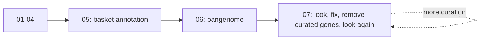

# Pangenome Analysis Pipeline Documentation

This repository documents the **pangenome analysis workflow**. The pipeline consists of several steps, each with its own `README.md` and a `scripts/` folder containing the associated codes.

**Internal document.** This is primarily an internal working document: the scripts are mostly
SLURM scripts, including code already adapted for our shared containers/installations. They
will eventually need editing to add paths to environments that aren't shared. They should also
be adapted/reviewed before being made public, as they contain comments that make sense to our
working group but not to outside readers.


Most pangenome tools call pangenes by
**sequence-similarity clustering**: throw every protein from every genome into one pool,
cluster by similarity, and each cluster becomes one pangene. One of the main issues with the clustering method is that it cannot separate paralogs properly while GET_PANGENES, because it uses the synteny information, paralogs will be considered independent pangenes.

Here we chose to use [GET_PANGENES](https://github.com/Ensembl/plant-scripts), which calls pangenes by **similarity** and **synteny**: it performs whole-genome alignments (WGA) for every assembly to define clusters of collinear, orthologous gene features from each genome's GFF annotation. Such clusters define the pangenes that make up the pangenome
([Contreras-Moreira et al. 2023](https://link.springer.com/article/10.1186/s13059-023-03071-z)).


Both methods are only as good as the gene annotation they're given. Real genes might be missing from the annotation, creating a false absence in the pangenome matrix, and false gene calls might inflate the accessory genome.

So before running GET_PANGENES, this pipeline was developed to get consistent gene annotation across all genome assemblies:

| Step | |
|---|---|
| [01 – Genome Selection & QC](01_Genome_Selection_QC/README.md) | Selects and quality-checks the genome set itself, and normalizes every assembly/GFF into one consistent naming convention every later step relies on. Profiles every contig's size and whether the small ones carry genes, to see how contiguous each assembly actually is and catch species-specific peculiarities (e.g. Tgondii's fragmented mitochondrial genome). Screens for and removes organelle (mitochondrial/apicoplast) and redundant/duplicate contigs avoiding inflated gene counts from genome redundancy, and false PAV from inconsistent organelle-genome inclusion across the panel.|
| [02 – TE Annotation & Clean Up](02_TE_annotation_Clean_Up/README.md) | Builds a species-specific curated TE library and annotates every genome with it, giving a TE-composition picture per genome (total content, superfamily/family breakdown). Scores how much of each annotated gene's CDS overlaps a TE and filters out genes that are probably TEs. Keeping TEs annotated as genes inflates the cloud (rare/strain-specific) gene category, since TEs are expected to insert at different locations in different strains. **Starships** (giant mobile elements in fungi that carry real host genes as cargo) are deliberately kept, not removed — their cargo genes are genuine; identifying the Starships is a step we need to do later when we have the pangenome results. |
| [03 – *de novo* Genome Annotation](03_denovo_Genome_Annotation/README.md) | **Optional** — only for genomes with no gene annotation at all. For fungal genomes, runs **Funannotate**, a standard *de novo* annotator. Without this step, the assembly could still get by on genes transferred from other strains (step 05's Liftoff) — but any gene truly unique to this strain, with no counterpart in any other genome's annotation, would never be captured that way. |
| [04 – Protein evidence (InterProScan and PSAURON)](04_Protein_evidence/README.md) | Some genomes may already carry InterPro domain annotation in their description, but for every genome to be on the same InterProScan version, this step re-runs it across the panel — the presence of an InterPro domain is used as evidence in step 05. It also scores every protein with PSAURON (how much it looks like a real protein-coding gene), used in step 05 to decide which new genes enter the panel. |
| [05 – Cross-genome annotation integration](05_Basket_annotation_integration/README.md) | Different genomes usually arrive annotated by different groups and tools, so the same gene can be called in one genome and missed in another, split in one and fused in another. To get a consistent annotation, every genome's genes are transferred onto every other genome (all-vs-all Liftoff), the versions of each gene are grouped across genomes (**baskets**), one model is chosen per gene (the reference's model when the reference has the gene; otherwise by protein domain, PSAURON score and how many genomes support it), and each genome takes the valid model most similar to it (the chosen model's own transfer whenever it works; a gene is only called absent after a last rescue, and every absence is listed with its reason). A gene not annotated in the reference enters the panel only if it has a protein domain, or a valid ORF of at least 100 aa with a high PSAURON score; the reference's pseudogenes are kept, tagged; when two genes overlap on opposite strands, the one that loses the comparison (reference gene, protein domain, PSAURON score, genomes with a valid ORF) is considered false and removed; broken models are repaired with miniprot when the genome sequence allows it.<br><br>**Caveats:**<br>- a gene model with a valid ORF doesn't mean it's expressed or functional, since only the coding sequence is checked — a mutation in a regulatory region (e.g. promoter) that silences the gene would go undetected;<br>- gene models with invalid ORFs could be genuine pseudogenes or functional genes whose CDS carries a sequencing or assembly error; they are kept and flagged (`orf_status`), which minimizes false PAV calls. |
| [06 – GET_PANGENES](06_GET_PANGENES/README.md) | Links each genome's already-ready GFF and FASTA into one directory, paired up by filename the way GET_PANGENES expects, then builds the actual pangenome — the similarity + synteny gene calling described above — from the cleaned-up, cross-genome-consistent annotations steps 01–05 produced. Runs on step 05's annotation; whether it runs again after step 07 is not decided yet. |
| [07 – Post-GET_PANGENES adjusting](07_Post_GET_PANGENES_adjusting/README.md) | Uses the pangenome to correct the annotation, judging each gene across all genomes. **Being revised:** the overlapping false genes and the genes deleted by the reference's curation are removed in step 05. Under discussion: genes annotated in pieces, absences where the sequence is there, the genes with an invalid ORF (including which are pseudogenes), and the low-quality pangenes. |


**The order of the steps.** Step 05 builds the final annotation (it chooses each gene's model, repairs broken models,
removes the false genes and the genes deleted by the reference's curation), and step 06 runs on it. Step 07, which
uses the pangenome to correct the annotation, is being revised: what it does, and whether step 06 then runs a second
time, is not decided yet.



1. Steps 01-04: genomes, TEs, *de novo* annotation if needed, InterProScan and PSAURON.
2. Step 05: all-against-all Liftoff, baskets and their winners, each genome's model, miniprot repair, the overlap rule
   and the reference's curation: the final GFFs.
3. Step 06: the pangenome.
4. Step 07: figures and an interactive page of the pangenome, tables of the absences and of the likely false genes, a
   safe fix of the genes `get_pangenes` split into two pangenes, the removal of the genes found false during curation,
   and the figures and page again. The removal can be repeated after each round of curation.

## Steps

- **[01 - Genome Selection & QC](01_Genome_Selection_QC/README.md)** 
- **[02 - TE Annotation & Clean Up](02_TE_annotation_Clean_Up/README.md)**
- **[03 - *de novo* Genome Annotation ](03_denovo_Genome_Annotation/README.md)** 
- **[04 – Protein evidence (InterProScan and PSAURON)](04_Protein_evidence/README.md)** 
- **[05 – Cross-genome annotation integration](05_Basket_annotation_integration/README.md)** 
- **[06 - GET_PANGENES](06_GET_PANGENES/README.md)** 
- **[07 - Post-GET_PANGENES Adjusting and Visualisation](07_Post_GET_PANGENES_adjusting/README.md)**


---

## Pangenome analysis reports

Results of this pipeline for each species analysed so far. These are curated reports (the full
technical write-up plus the figures/tables it references) - the full working data behind them
(raw assemblies, intermediate GFFs, InterProScan/Liftoff output, etc.) is not published here, as
it runs from hundreds of MB to several GB per species.

- **_Aspergillus fumigatus_**
  - [Summary](results/Afum/SUMMARY.md)
  - [Full report](results/Afum/README.md)
- **_Toxoplasma gondii_**
  - [Summary](results/Tgondii/SUMMARY.md)
  - [Full report](results/Tgondii/README.md)

---

## Alternative Get-PanLoci Pipeline

GET_PANGENES calls pangenes from annotated gene models, so its results are bounded by annotation quality — the reason steps 01–05 exist. The [Alternative Get-PanLoci Pipeline](Alternative_Get_PanLoci_pipeline/README.md) takes a different approach for cases where annotation is inconsistent or missing across the panel: it builds a whole-genome alignment with Cactus and uses `halLiftover` to project each **panlocus** (a genomic interval, not necessarily an annotated gene) across every genome, then validates each transfer at the DNA sequence level with `minimap2`, independent of whether the target strain has a gene call there. It runs as its own pipeline rather than as a step in the sequence above.

---

## Getting the pipeline into a project

Clone or download this repository into the root folder of the species project you're working
on, so its step folders sit directly under it, alongside your own `genomes/`,
`gff_originals/`, and `genome_order.txt`:

```bash
git clone https://github.com/adriludwig/pangenome-pipeline.git <project>/
```

```
<project>/
├── 01_Genome_Selection_QC/
│   └── scripts/
├── 02_TE_annotation_Clean_Up/
│   └── scripts/
├── 03_denovo_Genome_Annotation/
│   └── scripts/
├── 04_Protein_evidence/
│   └── scripts/
├── 05_Basket_annotation_integration/
│   └── scripts/
├── 06_GET_PANGENES/
│   └── scripts/
├── 07_Post_GET_PANGENES_adjusting/
│   └── scripts/
├── genome_order.txt            the genome list (generated in step 01)
├── genomes/                    <basename>.fna    – assemblies
└── gff_originals/              <basename>.gff3   – each genome's own annotation
```

`genomes/`, `gff_originals/`, `genome_order.txt` are yours to create in step 01. 

Every script has an `### ADAPT ###` block
(cluster module names / conda-env paths / container paths) and, occasionally, a project-specific variable at the top of the script (e.g.
which genome is the reference).

If a script fails with `Permission denied`, restore the executable bit on all scripts:

```bash
chmod +x $(find . -name "*.sh")
```